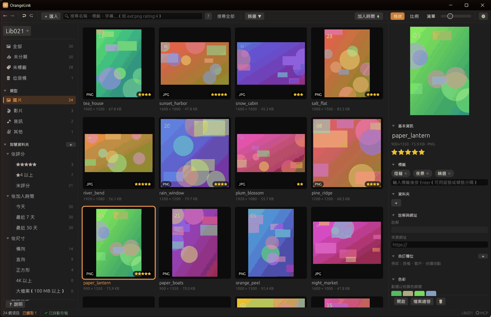
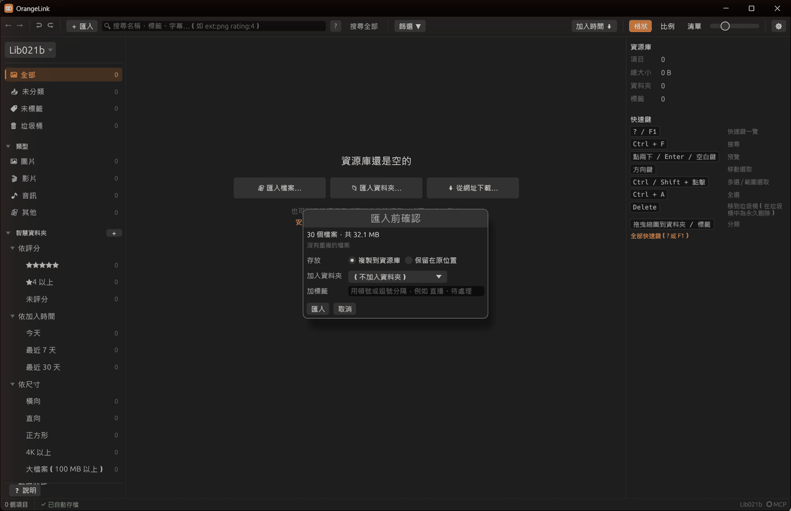
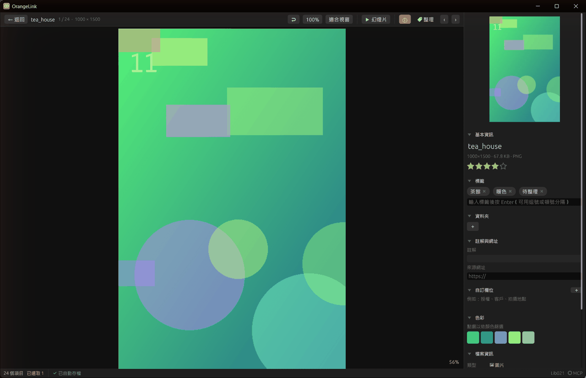
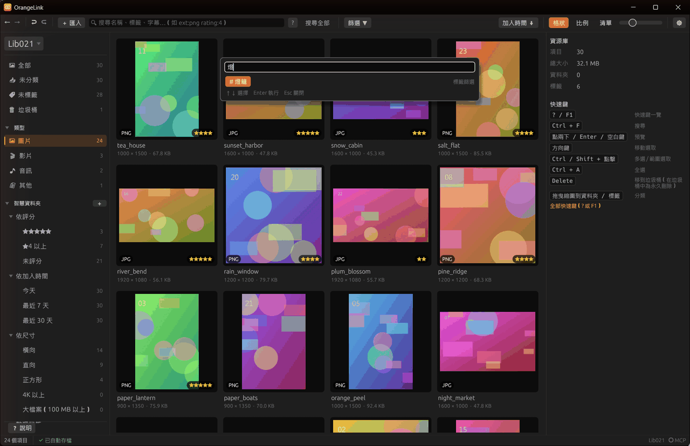
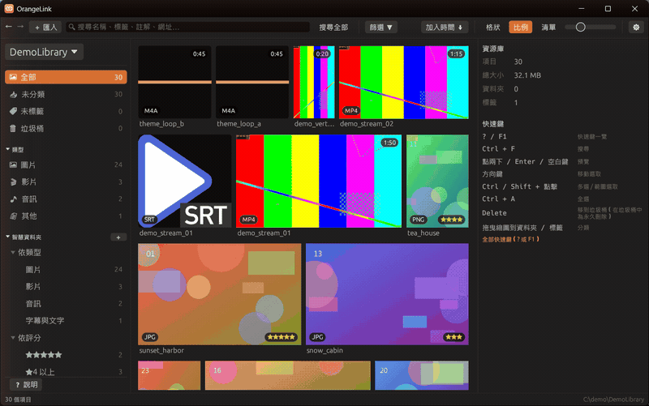
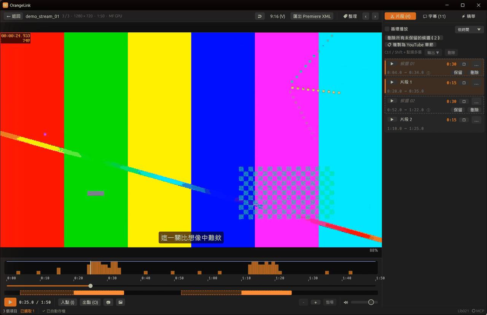
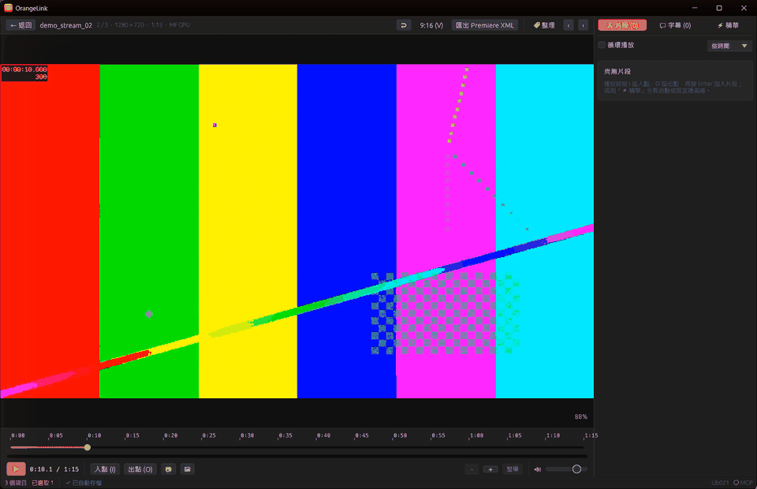
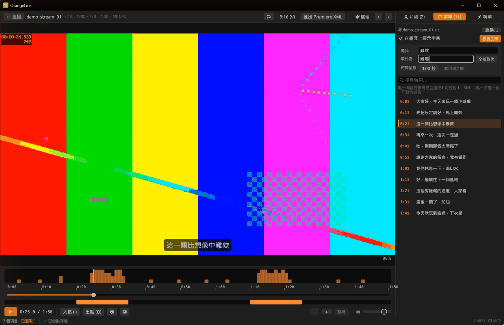
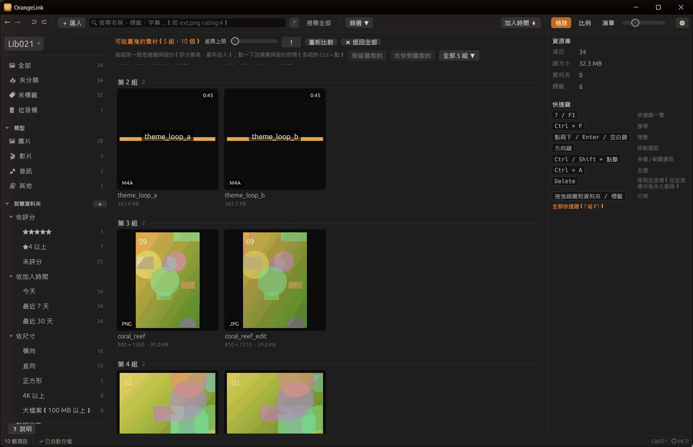
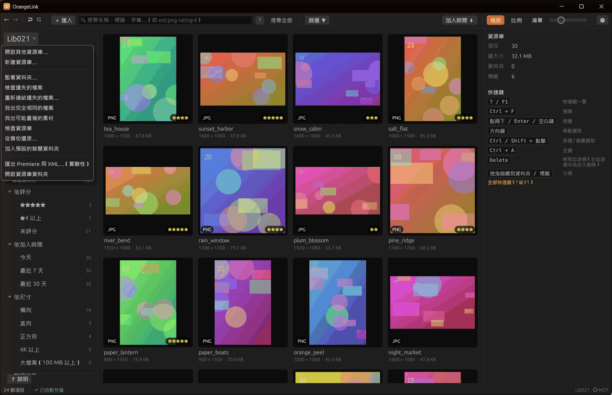

# OrangeLink

**繁體中文** · [简体中文](docs/README.zh-CN.md) · [English](docs/README.en.md) · [日本語](docs/README.ja.md) · [한국어](docs/README.ko.md)

*OrangeLink is a Windows desktop app for organizing images, video, audio and subtitles in one library, and for turning long recordings (such as live-stream archives) into short clips. It is a single executable written in Rust with [egui](https://github.com/emilk/egui), with no installer and no database. The interface is available in Traditional Chinese, Simplified Chinese, English, Japanese and Korean; the detailed documentation is in Traditional Chinese.*



## 這是什麼

OrangeLink 是 Windows 上的素材管理與影片剪輯工作流工具。你可以把圖片、影片、音訊、字幕和其他檔案集中在一個資源庫裡，用標籤、評分和資料夾整理，再用搜尋語法快速找出要用的素材。

它特別適合會處理長影片的人，例如直播錄影或訪談：可以在同一個地方搜尋與校對字幕、在可縮放的時間軸上標記片段、審核精華候選、輸出直式短片，並匯出成 Premiere Pro 的 XML。

- 單一執行檔，解壓縮就能用，不需要安裝程式。
- 資源庫是純檔案結構，沒有資料庫，隨時可以備份或用其他工具讀取。
- 語音轉文字、播放和縮圖都在本機處理；程式不會自動上傳你的素材或記錄。
- 介面有繁體中文、简体中文、English、日本語、한국어，可隨時切換（設定 →「一般」→「語言」）。

## 主要功能

### 整理素材：資源庫、標籤、智慧資料夾

- 圖片、影片、音訊、字幕與其他檔案集中管理，可建立多個資源庫。
- 匯入時可以「複製到資源庫」，也可以「保留在原位置」只建立索引與縮圖，適合大型素材庫。
- 一次拖進很多檔案時，會先顯示檔案數、總大小和重複數，讓你決定放進哪個資料夾、加哪些標籤，確認後才匯入。
- 資料夾、標籤、★1–5 評分、註解、自訂欄位；可以設定「監看資料夾」，新檔案自動匯入並加標籤。
- 按 `Ctrl + K` 快速跳到資料夾、標籤、智慧資料夾或設定頁，也能把選取的項目直接放進資料夾；可以複製一個項目的標籤、資料夾與欄位，貼到其他項目上。
- 可以並排比較 2 到 4 張圖片；檢視圖片時旁邊有資訊面板。
- 智慧資料夾把搜尋與篩選條件存成動態的資料夾。







### 搜尋

名稱、標籤、註解、網址和字幕台詞都能搜尋，並支援組合條件，例如 `ext:png rating:4`、`貓 OR 狗`、`-草稿`、`dur>10m`、`w>=1920`。完整語法在程式裡按 `?` 就能看到，也列在 [docs/FEATURES.md](docs/FEATURES.md)。



### 預覽影片、字幕與片段

- 影片與音訊直接在程式內播放，預設用 Windows 的 Media Foundation（GPU 硬體解碼），開不了的格式自動改用 FFmpeg。
- 自動找同名的 `.srt`／`.vtt` 字幕，預覽時列出每句台詞，點一句就跳到那個時間；也可以用 Whisper 在本機把影片或音訊轉成字幕。
- 字幕可以直接校對：改字、改時間、合併、分割，都能復原；搜尋字幕時會標出所有符合的行，逐一跳過去。連續幾行字幕可以一鍵做成片段。
- 剪輯工作台的時間軸可以縮放、捲動，有時間刻度與總覽條，長影片也好操作。
- 按 I／O 標記入點與出點，加入片段並輸出成檔案（含 Shorts 用的直式 1080×1920 預設組）。片段可以一鍵輸出，進度與剩餘時間顯示在背景工作，輸出過的片段會打勾；也能複製成 YouTube 章節。







### 直播精華候選與 Premiere XML

預覽直播錄影時，進度條上方可以顯示聊天室熱度（讀取和影片同名的 `.live_chat.json`）與音量，並自動在高峰前後建立精華候選，標出被選上的原因。候選片段用 ↑ ↓ 切換，按 Y 保留、N 刪除。選好的片段可以匯出成 Premiere Pro 用的 XML（實驗性，不保證每個版本都能完整讀取）。

### 相似與重複

可以找出內容完全相同的檔案，或縮圖相似的素材；結果分組顯示，可以保留一個、合併標籤與註解，或把其他的移到垃圾桶，操作都可以復原。



### 資料安全

修改每 2 秒自動存檔，並每天自動備份，可以從資源庫選單還原；資料夾結構檔損壞時會自動從備份取回。永久刪除預設只移除資源庫資料、保留你的原始檔。



更多功能（PDF 預覽、全域快捷鍵、批次重新命名、使用紀錄、深色與淺色主題等）見 [docs/FEATURES.md](docs/FEATURES.md)。

## 下載與安裝

**系統需求：Windows 10 或 11（64 位元）。**

1. 到 [GitHub Releases](https://github.com/rightstar2015/OrangeLink/releases) 下載 `OrangeLink-v版本-windows-x64.zip`。
2. 解壓縮到任何資料夾，執行 `OrangeLink.exe`。
3. 可以用同一個 Release 附的 `SHA256SUMS.txt` 確認下載沒有損壞：`sha256sum -c SHA256SUMS.txt`。

下面這些外部工具**不包含**在 zip 裡，需要時另外安裝（都可以在程式裡一鍵安裝）：

| 工具 | 用途 |
| --- | --- |
| [FFmpeg](https://ffmpeg.org/) | 影片縮圖、播放備援、片段輸出、語音轉字幕（語音轉字幕需要內建 whisper 的 FFmpeg 8 以上） |
| [yt-dlp](https://github.com/yt-dlp/yt-dlp) | 從網址下載影片、音訊與直播聊天室 |

沒有安裝它們也能使用其他功能。新版本發布後，OrangeLink 會提示有新版，請到 GitHub Releases 手動下載更新（細節見 [docs/FEATURES.md](docs/FEATURES.md#更新與回報問題)）。0.1.6 到 0.1.9 版不會提示之後的新版，請手動下載一次。

## 快速上手

1. 開啟 OrangeLink，按「＋ 新建資源庫…」選一個資料夾。
2. 把圖片、影片或整個資料夾拖進視窗；超過 20 個檔案時會先出現匯入前確認。
3. 點素材選取，按 `0`～`5` 評分；在右側面板輸入標籤後按 Enter。
4. 按 `Ctrl + F` 搜尋，或點左側的類型、資料夾、標籤、智慧資料夾瀏覽。
5. 雙擊影片預覽，按 I／O 標記片段，在右側的「字幕」分頁跳到想要的台詞。
6. 按 `?` 或 F1 查看所有快速鍵。

## 快速鍵

按 `?` 或 F1 可以在程式裡開啟這張表。

一般：

| 按鍵 | 動作 |
| --- | --- |
| ? / F1 | 快速鍵一覽 |
| Ctrl + F | 搜尋 |
| Ctrl + K | 前往資料夾、智慧資料夾、標籤或執行指令（有選取時也能直接加入資料夾或標籤） |
| Alt + ← / Alt + → | 上一個 / 下一個檢視（資料夾、標籤、搜尋、相似結果…，含捲動位置與選取；滑鼠側鍵也可以） |
| Ctrl + Z / Ctrl + Y | 復原 / 重做（標籤、評分、名稱、資料夾、智慧資料夾、標籤群組、欄位等修改，含 AI 的修改） |
| Ctrl + C | 複製選取的檔案（可貼到檔案總管、Premiere） |
| Ctrl + V | 匯入剪貼簿裡的檔案或截圖 |
| Ctrl + Alt + Shift + O | 在任何程式裡叫出 OrangeLink 並聚焦搜尋框（可在設定修改） |

格狀檢視：

| 按鍵 | 動作 |
| --- | --- |
| 點兩下 / Enter / 空白鍵 | 預覽 |
| 方向鍵 | 移動選取 |
| Ctrl / Shift + 點擊 | 多選 / 範圍選取 |
| 在空白處拖曳 | 框選（按住 Ctrl / Shift 可加選；清單檢視可從名稱以外的欄位開始拖曳） |
| Ctrl + A | 全選 |
| 0～5 | 為選取的項目評分（0 = 清除） |
| F2 | 重新命名：單選時直接在名稱位置編輯（Enter 確認、Esc 取消），多選時開啟批次重新命名 |
| Delete | 移到垃圾桶（在垃圾桶中為永久刪除） |
| Ctrl + 滾輪 | 調整縮圖大小（格狀、比例檢視） |
| 拖曳縮圖到資料夾 / 標籤 | 分類 |
| Esc | 取消選取 |

預覽圖片與 PDF：

| 按鍵 | 動作 |
| --- | --- |
| ← / → / ↑ / ↓ | 上一張 / 下一張（PDF 為換頁，翻過最後一頁換到下一個素材） |
| PageUp / PageDown | PDF 換頁 |
| Ctrl + ← / → | 上一個 / 下一個素材 |
| 滾輪 | 縮放（PDF 為換頁，Ctrl + 滾輪縮放） |
| 點兩下 | 在符合視窗與 100% 之間切換 |
| 0～5 | 為目前的素材評分 |
| Esc / Enter / 空白鍵 | 關閉預覽 |

預覽影片與音訊：

| 按鍵 | 動作 |
| --- | --- |
| 空白鍵 / K | 播放或暫停 / 暫停並回到正常速度 |
| L | 播放；播放中再按加速到 2×、4×（Media Foundation） |
| ← / → | 倒退 / 前進 5 秒 |
| Shift + ← / → | 倒退 / 前進 1 秒 |
| , / . | 上一格 / 下一格（會先暫停） |
| J | 倒播，再按加快（Media Foundation；FFmpeg 播放引擎是倒退 5 秒） |
| Home / End | 跳到開頭 / 結尾 |
| I / O | 設定片段入點 / 出點 |
| Enter | 有入點或出點時加入片段 |
| V | 切換 9:16 裁切框（橫式影片） |
| Ctrl + ← / →、PageUp / PageDown | 上一個 / 下一個素材 |
| ↑ / ↓、[ / ] | 上一個 / 下一個片段（選取並播放） |
| Y / N | 保留 / 刪除選取的片段，再跳到下一個（可復原） |
| Delete | 片段分頁有選取片段時，刪除這些片段（可復原） |
| 0～5 | 為目前的素材評分 |
| Esc | 關閉預覽 |

跳轉時畫面中央會短暫顯示「+5s」之類的提示。拖曳時間軸時，Media Foundation 會一路顯示經過的畫面（播放中會先暫停，放開後從該處繼續）；FFmpeg 則在放開後才跳轉。暫停時跳轉或逐格也會顯示該位置的畫面。片段列表的 ▶ 播到出點會停止，勾選「循環播放片段」則會從入點重播。

## 進階功能

- **AI 整理（MCP）**：在設定中啟用本機 MCP 伺服器後，Claude 等 AI 助理可以搜尋素材、看縮圖、加標籤、評分、整理資料夾。預設只能查看；修改資料庫要另外授權，每次修改都可以復原，AI 不會刪除素材或任何檔案。只接受本機連線，需要 token。設定步驟、工具列表與權限說明見 [docs/FEATURES.md](docs/FEATURES.md#ai-整理mcp)，安全性設計見 [SECURITY.md](SECURITY.md)。
- **瀏覽器擴充功能（Brave / Chrome / Edge）**：在網頁的圖片、影片或檔案連結上按右鍵「加入 OrangeLink」，直接進入資源庫並記錄來源頁面。只接受本機連線與正確的配對碼；可執行檔等危險格式會被拒收。安裝步驟與權限說明見 [docs/FEATURES.md](docs/FEATURES.md#瀏覽器擴充功能brave--chrome--edge)，安全性見 [SECURITY.md](SECURITY.md)。
- **擴充套件**：把你自己電腦上的一個資料夾加入並信任後，OrangeLink 可以把影片或音訊交給它，請它找精華片段，結果會變成剪輯工作台裡的精華候選，照平常方式審核。擴充用資料夾裡的一份 JSON 清單描述，只在本機執行，不能直接修改資源庫，整批結果可以復原。信任擴充就是信任它的程式碼，請只加入你自己寫的或信任的擴充。格式與寫法見 [docs/EXTENSIONS.md](docs/EXTENSIONS.md)。
- **從網址下載**：「＋ 匯入」→「從網址下載」，透過你安裝的 yt-dlp 下載 mp4、mp3、m4a 或直播聊天室並自動匯入。請只下載你有權使用的內容，並遵守各網站的使用條款與著作權法規。細節見 [docs/FEATURES.md](docs/FEATURES.md#從網址下載yt-dlp)。

## 從原始碼建置

需要 Rust（版本固定在 `rust-toolchain.toml`，rustup 會自動安裝那一版）：

```powershell
cargo build --release --locked
```

執行檔在 `target\release\orangelink.exe`。開發時請用 `.\scripts\dev-sandbox.ps1` 執行，它會把設定和資源庫放在 `_test_sandbox\` 而不是你真實的 `%APPDATA%`。測試、commit 規則和參與開發的方式見 [CONTRIBUTING.md](CONTRIBUTING.md)。發布是維護者的工作，見 [docs/RELEASING.md](docs/RELEASING.md)。

## 授權、致謝與免責聲明

OrangeLink 以 [MIT 授權](LICENSE) 釋出。部分檔案改寫自 [Prime Files](https://github.com/CakeDev4k/prime-files)（MIT）；介面配色以 [Catppuccin](https://github.com/catppuccin/egui)（MIT）為基礎。編譯進執行檔的套件與字型，以及不隨附的外部程式（FFmpeg、yt-dlp、Whisper 模型等），都列在 [THIRD_PARTY_NOTICES.md](THIRD_PARTY_NOTICES.md)。

OrangeLink 是獨立專案，與任何商業素材管理軟體沒有隸屬或相容關係。Adobe 與 Premiere Pro 是 Adobe 的商標，本專案與 Adobe 沒有隸屬關係；匯出的 XML 是一般的交換格式，不保證每個 Premiere Pro 版本都能完整讀取。本軟體依 MIT 授權「按現狀」提供，不附任何擔保；請自行備份重要的素材與資源庫。

## 回報問題

- 一般問題與建議：到 [GitHub Issues](https://github.com/rightstar2015/OrangeLink/issues) 開一個 issue（需要 GitHub 帳號）。程式裡的「❓ 說明」→「回報問題」也會開啟同一個頁面。
- 回報時可以從「…」選單複製最後 200 行記錄貼上；記錄裡的使用者資料夾會寫成 `~`，token 和配對碼會隱藏，也不會自動上傳。
- **安全性問題請不要開公開的 issue**，回報方式見 [SECURITY.md](SECURITY.md)。
