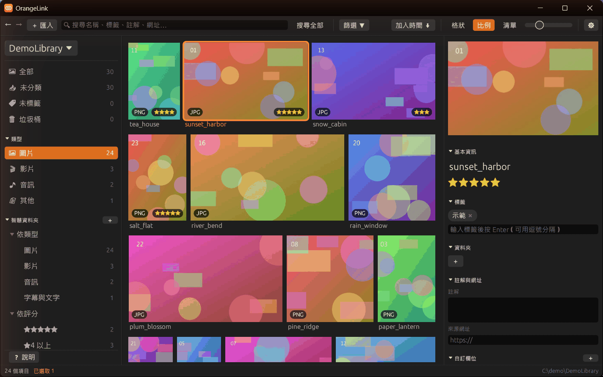
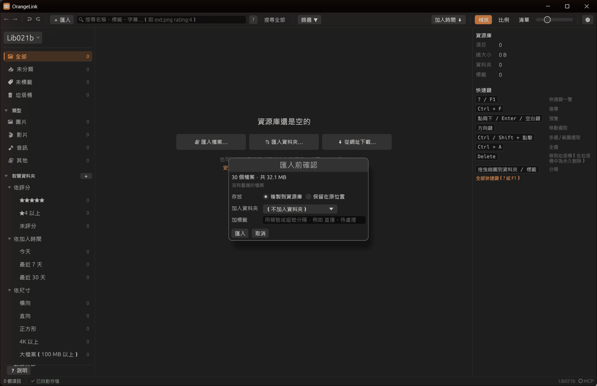
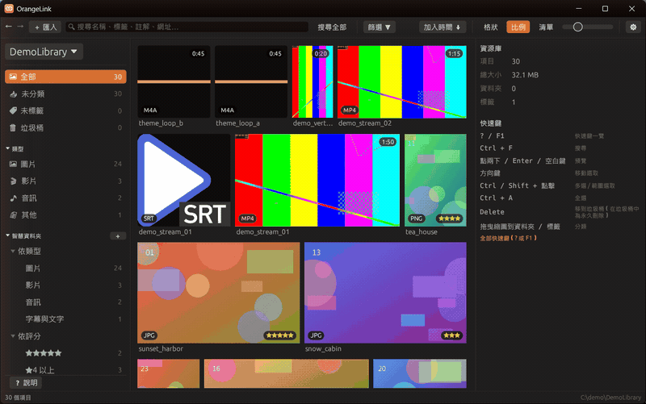
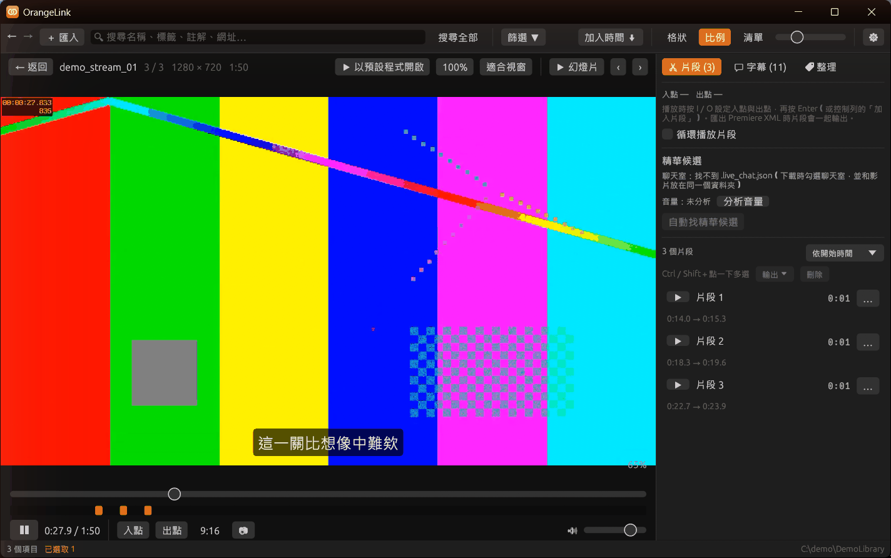
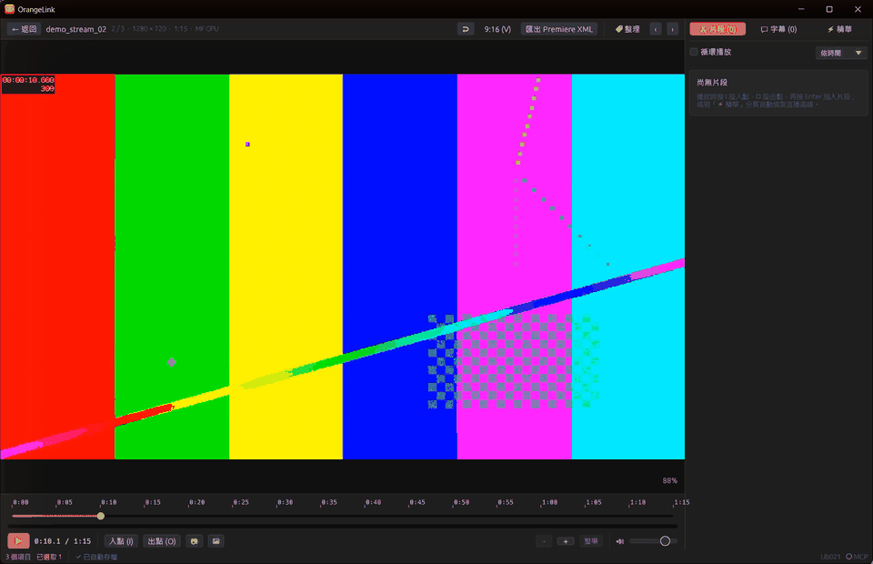
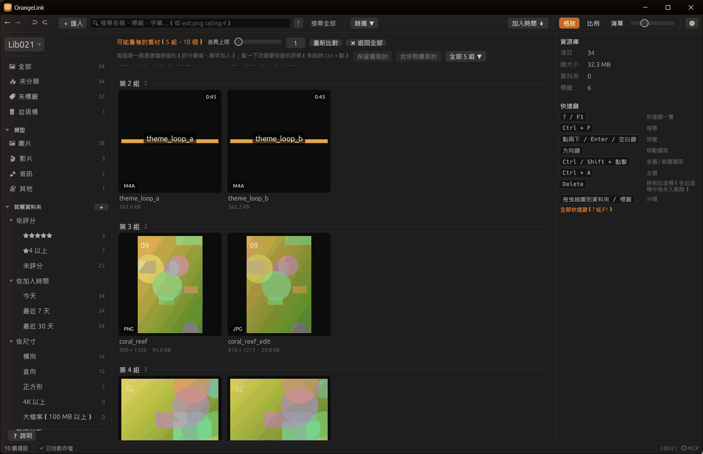
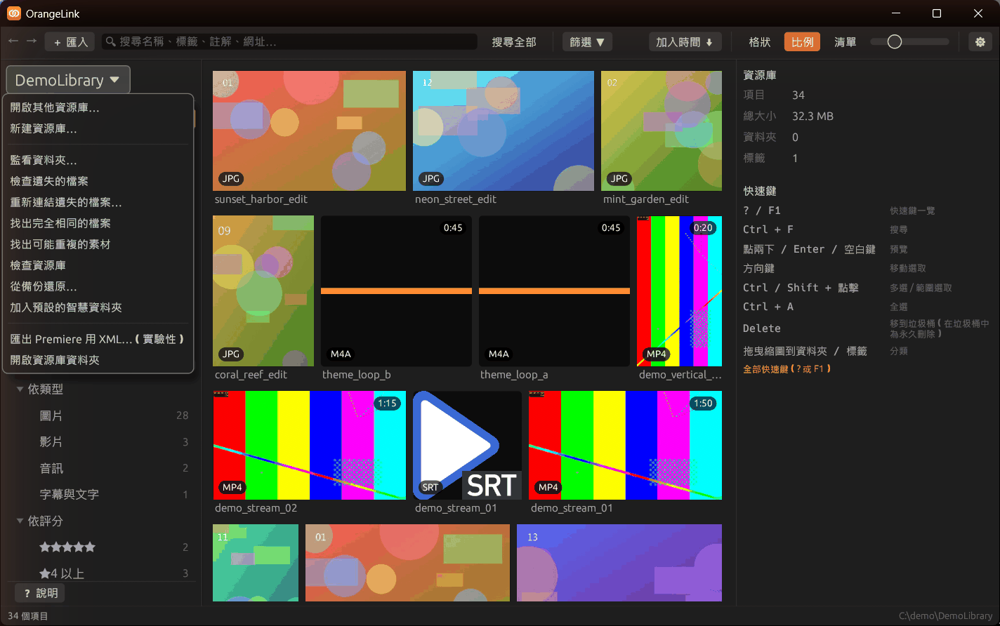

# OrangeLink

[繁體中文](../README.md) · [简体中文](README.zh-CN.md) · **English** · [日本語](README.ja.md) · [한국어](README.ko.md)

*The interface is available in Traditional Chinese, Simplified Chinese, English, Japanese and Korean (Settings → General → Language). The detailed docs (FEATURES.md) are in Traditional Chinese.*



## What is it

OrangeLink is an asset management and video editing workflow tool for Windows. You can collect images, videos, audio, subtitles and other files in one library, organize them with tags, ratings and folders, and quickly find the assets you need with search syntax.

It is especially useful for people who work with long videos, such as livestream recordings or interviews. You can search and proofread subtitles, mark clips on a zoomable timeline, review highlight candidates, export vertical short videos, and export to Premiere Pro XML, all in one place.

- A single executable. Extract it and run; no installer needed.
- The library is plain file structure with no database, so you can back it up or read it with other tools at any time.
- Speech-to-text, playback and thumbnails are all processed locally. The program does not automatically upload your assets or logs.
- The interface is available in Traditional Chinese, Simplified Chinese, English, Japanese and Korean, and can be switched at any time (Settings → General → Language).

> The screenshots below were taken from an earlier version. Since 0.2 the interface has changed (for example the clip workspace and the viewer's info panel), so the screens may look slightly different from what you see. The feature descriptions in the text are authoritative.

## Main features

### Organize assets: libraries, tags, smart folders

- Manage images, videos, audio, subtitles and other files together. You can create multiple libraries.
- When importing, you can "Copy to library", or "Keep in place" to create only an index and thumbnails, which suits large asset collections.
- When you drag in many files at once, it first shows the file count, total size and number of duplicates, so you can choose the folder and tags before confirming the import.
- Folders, tags, ★1–5 ratings, notes and custom fields. You can set up a watch folder so new files are imported automatically and tagged.
- Press `Ctrl + K` to quickly jump to a folder, tag, smart folder or the settings page, and you can also put the selected items straight into a folder. You can copy one item's tags, folders and fields and paste them onto other items.
- You can compare 2 to 4 images side by side; an info panel sits beside them when viewing images.
- Smart folders save search and filter criteria as dynamic folders.



### Search

Names, tags, notes, URLs and subtitle lines can all be searched, and conditions can be combined, for example `ext:png rating:4`, `cat OR dog`, `-draft`, `dur>10m` and `w>=1920`. Press `?` in the program to see the full syntax, which is also listed in [docs/FEATURES.md](FEATURES.md).



### Preview videos, subtitles and clips

- Videos and audio play directly in the program. By default it uses Windows Media Foundation (GPU hardware decoding), and formats it cannot open automatically fall back to FFmpeg.
- It automatically finds `.srt` / `.vtt` subtitles with the same name. While previewing, every subtitle line is listed, and clicking one jumps to that time. You can also use Whisper to generate subtitles from a video or audio file locally.
- Subtitles can be proofread directly: editing text and times, merging and splitting are all undoable. When you search subtitles, every matching line is highlighted and you can jump through them one by one. A run of consecutive subtitle lines can be turned into a clip in one click.
- The timeline in the clip workspace can be zoomed and scrolled, with a time ruler and an overview bar, so long videos are easy to work with.
- Press I / O to mark the in and out points, add the range as a clip, and export it to a file. This includes a preset for Shorts (vertical 1080×1920). Clips can be exported in one click; progress and remaining time show in background tasks, exported clips are checked off, and you can also copy them as YouTube chapters.





### Livestream highlight candidates and Premiere XML

When previewing a livestream recording, chat activity (read from the `.live_chat.json` file with the same name as the video) and volume can be shown above the progress bar. Highlight candidates are created automatically around the peaks, and each one is marked with the reason it was chosen. Use ↑ ↓ to move between candidates, press Y to keep one or N to delete it. Selected clips can be exported as XML for Premiere Pro (experimental; full compatibility with every version is not guaranteed).

### Similar and duplicate assets

You can find files with identical content, or assets with similar thumbnails. Results are shown in groups. You can keep one, merge tags and notes, or move the others to the Trash. All of these actions can be undone.



### Data safety

Changes are saved automatically every 2 seconds, and a backup is made automatically every day. You can restore from the library menu. If the folder structure file is damaged, it is automatically recovered from a backup. By default, permanent deletion only removes the library data and keeps your original files.



For more features (PDF preview, global shortcuts, batch renaming, usage history, dark and light themes, and more), see [docs/FEATURES.md](FEATURES.md).

## Download and install

**System requirements: Windows 10 or 11 (64-bit).**

1. Go to [GitHub Releases](https://github.com/rightstar2015/OrangeLink/releases) and download `OrangeLink-vVERSION-windows-x64.zip`.
2. Extract it to any folder and run `OrangeLink.exe`.
3. To verify the download is not corrupted, use the `SHA256SUMS.txt` file attached to the same Release: `sha256sum -c SHA256SUMS.txt`.

The following external tools are **not included** in the zip. Install them when needed (both can be installed with one click from within the program):

| Tool | Purpose |
| --- | --- |
| [FFmpeg](https://ffmpeg.org/) | Video thumbnails, playback fallback, clip export, speech-to-subtitles (speech-to-subtitles requires FFmpeg 8 or later with built-in Whisper) |
| [yt-dlp](https://github.com/yt-dlp/yt-dlp) | Download videos, audio and livestream chat from URLs |

The other features work without these tools. When a new version is released, OrangeLink will notify you, but please download the update manually from GitHub Releases (details in [docs/FEATURES.md](FEATURES.md#更新與回報問題)). Versions 0.1.6 through 0.1.9 do not notify you of later versions, so please download the newer version manually once.

## Quick start

1. Open OrangeLink, click "＋ New library…", and choose a folder.
2. Drag images, videos or whole folders into the window. If you add more than 20 files, the pre-import confirmation appears first.
3. Click an asset to select it, then press `0`–`5` to rate it. Type a tag in the right panel and press Enter.
4. Press `Ctrl + F` to search, or click the types, folders, tags or smart folders on the left to browse.
5. Double-click a video to preview it. Press I / O to mark clips, then use the "Subtitles" tab on the right to jump to the subtitle line you want.
6. Press `?` or F1 to see all keyboard shortcuts.

## Keyboard shortcuts

Press `?` or F1 in the program to open this table.

General:

| Keys | Action |
| --- | --- |
| ? / F1 | Keyboard shortcuts |
| Ctrl + F | Search |
| Ctrl + K | Go to a folder, smart folder or tag, or run a command (with items selected, also file or tag them) |
| Alt + ← / Alt + → | Previous / next view (folders, tags, searches, similar results…, with scroll position and selection; mouse side buttons work too) |
| Ctrl + Z / Ctrl + Y | Undo / redo (changes to tags, ratings, names, folders, smart folders, tag groups, fields and so on, including the AI's) |
| Ctrl + C | Copy the selected files (paste into File Explorer, Premiere) |
| Ctrl + V | Import files or a screenshot from the clipboard |
| Ctrl + Alt + Shift + O | Bring up OrangeLink from any program with the search box focused (can be changed in Settings) |

Grid view:

| Keys | Action |
| --- | --- |
| Double-click / Enter / Space | Preview |
| Arrow keys | Move the selection |
| Ctrl / Shift + click | Multi-select / range select |
| Drag on empty space | Box select (hold Ctrl / Shift to add; in list view, start dragging on any column except the name) |
| Ctrl + A | Select all |
| 0–5 | Rate the selected items (0 = clear) |
| F2 | Rename: with one selected, edit the name in place (Enter confirms, Esc cancels); with several, open batch rename |
| Delete | Move to Trash (in the Trash, delete permanently) |
| Ctrl + wheel | Change the thumbnail size (grid and justified views) |
| Drag thumbnails onto a folder / tag | File them |
| Esc | Deselect |

Previewing images and PDFs:

| Keys | Action |
| --- | --- |
| ← / → / ↑ / ↓ | Previous / next image (turns the page in a PDF, past the last page goes to the next asset) |
| PageUp / PageDown | Turn PDF pages |
| Ctrl + ← / → | Previous / next asset |
| Wheel | Zoom (turns pages in a PDF; Ctrl + wheel zooms) |
| Double-click | Switch between fit to window and 100% |
| 0–5 | Rate the current asset |
| Esc / Enter / Space | Close the preview |

Previewing video and audio:

| Keys | Action |
| --- | --- |
| Space / K | Play or pause / pause and return to normal speed |
| L | Play; press again while playing for 2×, 4× (Media Foundation) |
| ← / → | Back / forward 5 seconds |
| Shift + ← / → | Back / forward 1 second |
| , / . | Previous / next frame (pauses first) |
| J | Play backwards, press again to speed up (Media Foundation; the FFmpeg engine goes back 5 seconds) |
| Home / End | Jump to the start / end |
| I / O | Set the clip's in / out point |
| Enter | Add a clip when an in or out point is set |
| V | Toggle the 9:16 crop frame (landscape video) |
| Ctrl + ← / →, PageUp / PageDown | Previous / next asset |
| ↑ / ↓, [ / ] | Previous / next clip (selected and played) |
| Y / N | Keep / delete the selected clip, then go to the next (can be undone) |
| Delete | With clips selected in the Clips tab, delete them (can be undone) |
| 0–5 | Rate the current asset |
| Esc | Close the preview |

When jumping, a brief hint such as "+5s" appears in the center of the screen. When dragging the timeline, Media Foundation shows the frames as you pass them (if playing, it pauses first and resumes from where you release); FFmpeg only jumps after you release. When paused, jumping or stepping frame by frame also shows the frame at that position. In the clip list, ▶ plays up to the out point and then stops. If you check "Loop clips", it replays from the in point instead.

## Advanced features

- **AI organization (MCP)**: After enabling the local MCP server in Settings, AI assistants such as Claude can search assets, view thumbnails, add tags, rate assets and organize folders. By default they can only view. Changing the database requires separate authorization, and every change can be undone. The AI never deletes assets or any files. It only accepts local connections and requires a token. For setup steps, the tool list and permission details, see [docs/FEATURES.md](FEATURES.md#ai-整理mcp). For the security design, see [SECURITY.md](../SECURITY.md).
- **Browser extension (Brave / Chrome / Edge)**: Right-click an image, video or file link on a web page and choose "Add to OrangeLink". It goes straight into the library and records the source page. It only accepts local connections with the correct pairing code, and dangerous formats such as executables are rejected. For installation steps and permission details, see [docs/FEATURES.md](FEATURES.md#瀏覽器擴充功能brave--chrome--edge). For security, see [SECURITY.md](../SECURITY.md).
- **Extensions**: Add a folder on your own computer as an extension and trust it, and OrangeLink can hand videos or audio to it and ask it to find highlight clips. The results become highlight candidates in the clip workspace, to be reviewed as usual. An extension is described by a JSON manifest in its folder. It runs only locally and cannot modify the library directly, and the whole batch of results can be undone. Trusting an extension means trusting its code, so only add extensions you wrote yourself or trust. For the format and how to write one, see [EXTENSIONS.md](EXTENSIONS.md).
- **Download from URL**: Choose "＋ Import" → "Download from URL". It uses the yt-dlp you installed to download mp4, mp3, m4a files or livestream chat, and imports them automatically. Only download content you have the right to use, and follow each site's terms of use and copyright laws. Details: [docs/FEATURES.md](FEATURES.md#從網址下載yt-dlp).

## Building from source

Requires Rust (the version is pinned in `rust-toolchain.toml`; rustup installs that version automatically):

```powershell
cargo build --release --locked
```

The executable is at `target\release\orangelink.exe`. For development, run it with `.\scripts\dev-sandbox.ps1`. It keeps settings and libraries in `_test_sandbox\` instead of your real `%APPDATA%`. For testing, commit rules and how to contribute, see [CONTRIBUTING.md](../CONTRIBUTING.md). Releases are handled by the maintainers; see [docs/RELEASING.md](RELEASING.md).

## License, acknowledgements and disclaimer

OrangeLink is released under the [MIT License](../LICENSE). Some files were adapted from [Prime Files](https://github.com/CakeDev4k/prime-files) (MIT), and the interface colors are based on [Catppuccin](https://github.com/catppuccin/egui) (MIT). Packages and fonts compiled into the executable, as well as external programs that are not bundled (FFmpeg, yt-dlp, Whisper models, etc.), are all listed in [THIRD_PARTY_NOTICES.md](../THIRD_PARTY_NOTICES.md).

OrangeLink is an independent project and has no affiliation with or compatibility relationship to any commercial asset management software. Adobe and Premiere Pro are trademarks of Adobe; this project is not affiliated with Adobe. The exported XML is a general interchange format, and full compatibility with every Premiere Pro version is not guaranteed. This software is provided "as is" under the MIT License, without warranty of any kind. Please back up important assets and libraries yourself.

## Reporting issues

- For general questions and suggestions, open an issue on [GitHub Issues](https://github.com/rightstar2015/OrangeLink/issues) (a GitHub account is required). "❓ Help" → "Report issue" in the program opens the same page.
- When reporting, you can copy the last 200 lines of the log from the "…" menu and paste them. In the log, user folder paths are written as `~`, tokens and pairing codes are hidden, and nothing is uploaded automatically.
- **Please do not open a public issue for security problems.** For how to report them, see [SECURITY.md](../SECURITY.md).
