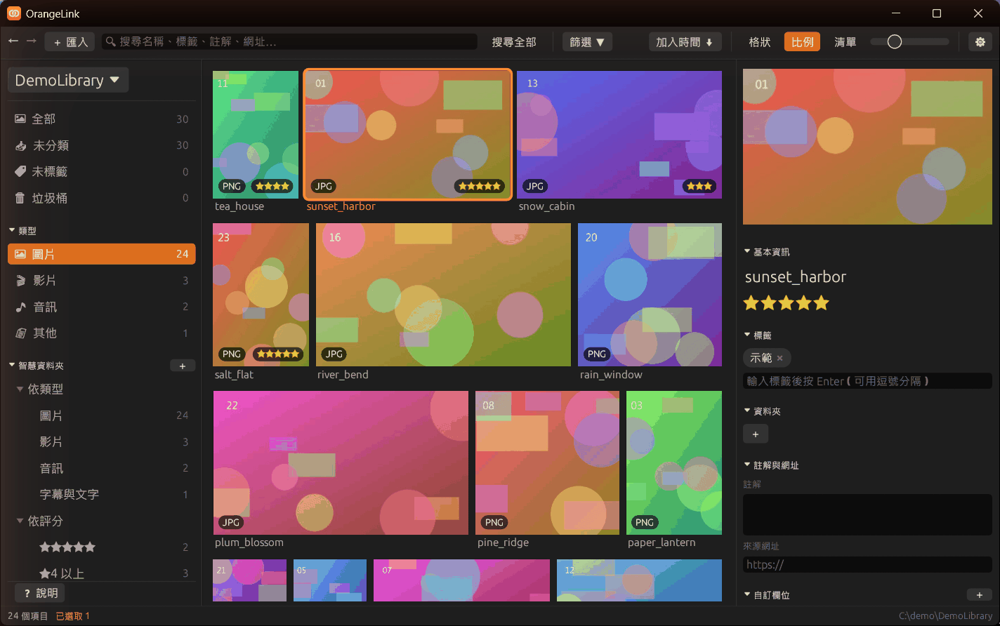
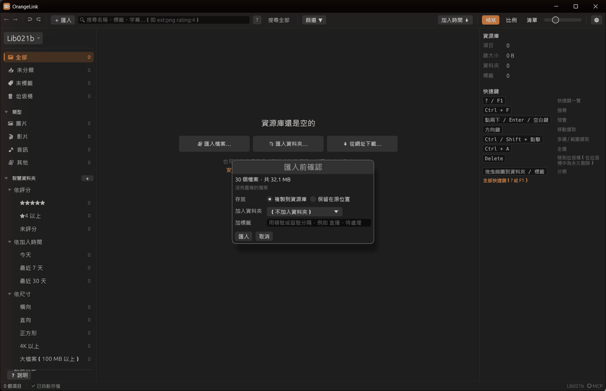
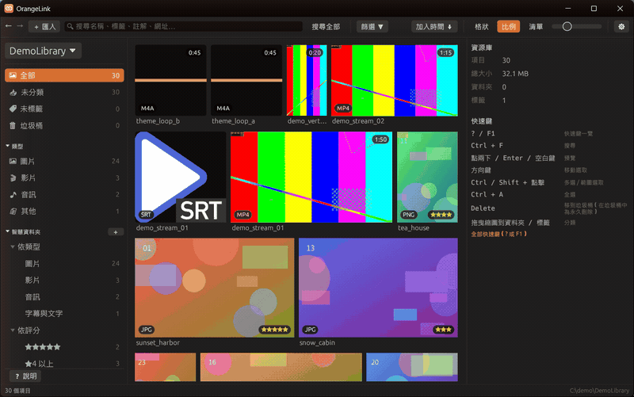
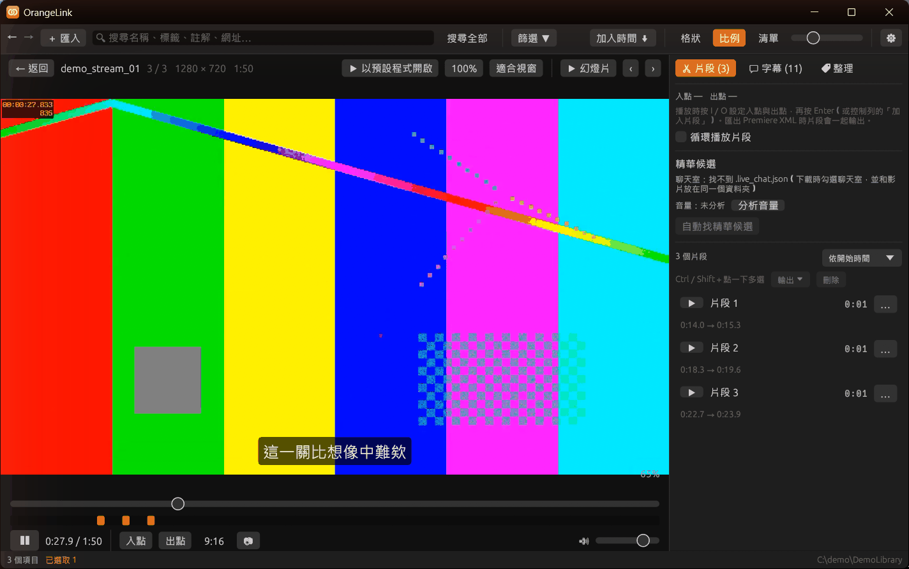
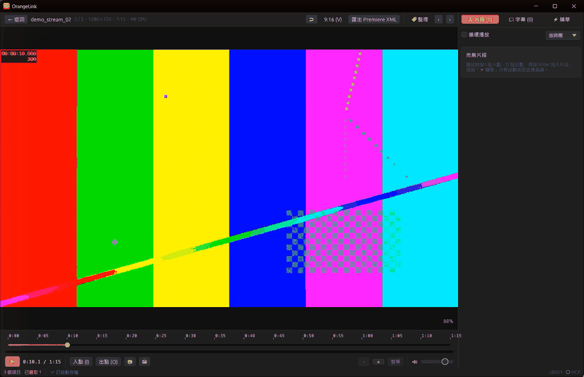
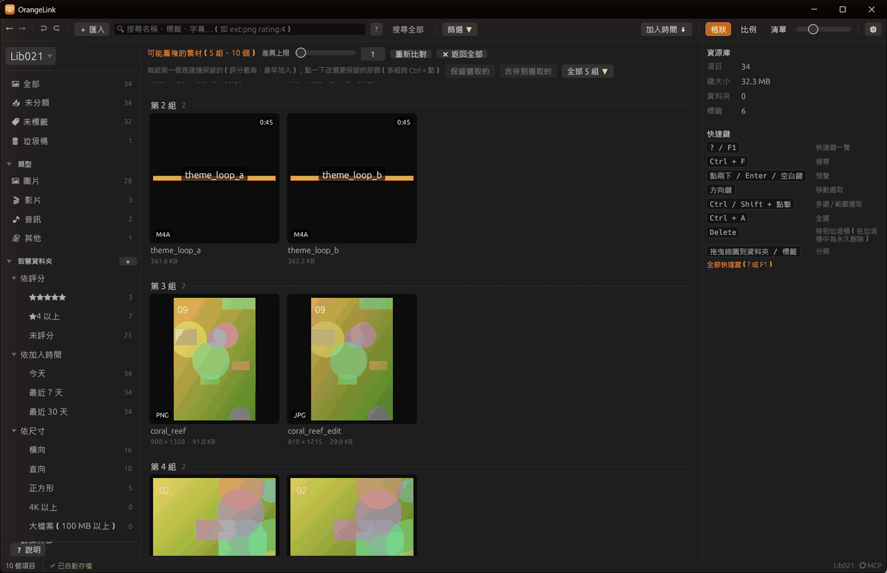
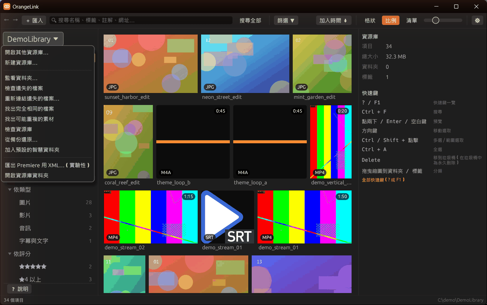

# OrangeLink

[繁體中文](../README.md) · [简体中文](README.zh-CN.md) · [English](README.en.md) · **日本語** · [한국어](README.ko.md)

*インターフェースは繁体字中国語、簡体字中国語、英語、日本語、韓国語で表示できます（設定 → 一般 → 言語）。詳しいドキュメント（FEATURES.md）は繁体字中国語で書かれています。*



## これは何か

OrangeLink は Windows 向けの素材管理・動画編集ワークフローツールです。画像、動画、音声、字幕、その他のファイルを1つのライブラリにまとめ、タグ、評価、フォルダーで整理してから、検索構文で必要な素材をすばやく見つけられます。

特に長い動画を扱う方に向いています。たとえば配信アーカイブやインタビューでは、同じ場所で字幕を検索し、動画に クリップ を付け、ハイライト候補を見つけ、縦型のショート動画を書き出し、Premiere Pro 用の XML として書き出せます。

- 単一の実行ファイルです。展開すればすぐ使え、インストーラーは不要です。
- ライブラリは純粋なファイル構造で、データベースはありません。いつでもバックアップしたり、ほかのツールで読み込んだりできます。
- 音声認識、再生、サムネイルはすべてローカルで処理されます。素材や記録が自動でアップロードされることはありません。

## 主な機能

### 素材の整理：ライブラリ、タグ、スマートフォルダー

- 画像、動画、音声、字幕、その他のファイルを一元管理でき、複数のライブラリを作成できます。
- インポート時は「ライブラリにコピー」することも、「元の場所に保持」してインデックスとサムネイルだけを作成することもできます。大規模な素材ライブラリに適しています。
- 一度に大量のファイルをドラッグすると、先にファイル数、合計サイズ、重複数が表示されます。保存先のフォルダーや付けるタグを決めてから、確認してインポートできます。
- フォルダー、タグ、★1–5 の評価、メモ、カスタム欄があります。「監視フォルダー」を設定すると、新しいファイルが自動でインポートされ、タグが付きます。
- スマートフォルダーは、検索と絞り込みの条件を動的なフォルダーとして保存します。



### 検索

名前、タグ、メモ、URL、字幕のセリフを検索できます。`ext:png rating:4`、`猫 OR 犬`、`-下書き`、`dur>10m`、`w>=1920` のように条件を組み合わせられます。完全な構文はアプリ内で `?` を押すと表示されるほか、[FEATURES.md](FEATURES.md) にも記載されています。



### 動画、字幕、クリップのプレビュー

- 動画と音声はアプリ内で直接再生されます。既定では Windows の Media Foundation（GPU ハードウェアデコード）を使い、開けない形式は自動的に FFmpeg に切り替わります。
- 同名の `.srt`／`.vtt` 字幕を自動で探し、プレビュー時には各セリフを一覧表示します。一文をクリックすると、その時刻にジャンプします。Whisper を使えば、動画や音声をローカルで字幕に変換することもできます。
- I／O キーでイン点とアウト点を設定し、クリップとして追加して、ファイルに書き出せます（ショート動画向けの縦型 1080×1920 プリセットを含みます）。





### 配信のハイライト候補と Premiere XML

配信録画をプレビューするとき、シークバーの上にチャットの盛り上がり（同名の `.live_chat.json` を読み込みます）と音量が表示されます。ピークの前後でハイライト候補を自動的に作成し、選ばれた理由も示します。選んだクリップは Premiere Pro 用の XML として書き出せます（実験的機能のため、すべてのバージョンで完全に読み込めるとは限りません）。

### 類似と重複

内容が完全に同じファイルや、サムネイルが似ている素材を見つけられます。結果はグループごとに表示され、1つを残してタグとメモを統合したり、そのほかのファイルをゴミ箱に移したりできます。どの操作も元に戻せます。



### データの安全性

変更は 2 秒ごとに自動保存され、毎日自動でバックアップされます。ライブラリのメニューから復元できます。フォルダー構造のファイルが壊れた場合は、バックアップから自動的に復旧されます。完全削除は既定でライブラリのデータだけを削除し、元のファイルは残します。



その他の機能（PDF プレビュー、グローバルショートカット、一括リネーム、利用履歴、ダーク／ライトテーマなど）は [FEATURES.md](FEATURES.md) を参照してください。

## ダウンロードとインストール

**動作環境：Windows 10 または 11（64 ビット）。**

1. [GitHub Releases](https://github.com/rightstar2015/OrangeLink/releases) から `OrangeLink-v版本-windows-x64.zip` をダウンロードします（「版本」の部分はバージョン番号です）。
2. 任意のフォルダーに展開し、`OrangeLink.exe` を実行します。
3. 同じ Release に付属する `SHA256SUMS.txt` を使うと、ダウンロードが破損していないか確認できます：`sha256sum -c SHA256SUMS.txt`。

以下の外部ツールは zip に**含まれていません**。必要なときに別途インストールしてください（いずれもアプリ内でワンクリックでインストールできます）。

| ツール | 用途 |
| --- | --- |
| [FFmpeg](https://ffmpeg.org/) | 動画のサムネイル、再生の代替、クリップ書き出し、音声からの字幕変換（音声から字幕への変換には、内蔵 whisper を含む FFmpeg 8 以降が必要です） |
| [yt-dlp](https://github.com/yt-dlp/yt-dlp) | URL から動画、音声、配信チャットをダウンロード |

これらがなくても、ほかの機能は使えます。新しいバージョンが公開されると、OrangeLink が新バージョンを通知します。その場合は GitHub Releases から手動でダウンロードして更新してください（詳細は [FEATURES.md](FEATURES.md#更新與回報問題) を参照）。0.1.6 から 0.1.9 のバージョンは、それ以降の新バージョンを通知しないため、一度手動でダウンロードしてください。

## クイックスタート

1. OrangeLink を開き、「＋ 新しいライブラリ…」を押して、フォルダーを選びます。
2. 画像、動画、またはフォルダー全体をウィンドウにドラッグします。20 個を超えるファイルの場合は、先にインポート前の確認が表示されます。
3. 素材を選択して `0`～`5` を押すと評価できます。右側のパネルでタグを入力し、Enter を押します。
4. `Ctrl + F` で検索するか、左側の種類、フォルダー、タグ、スマートフォルダーから閲覧します。
5. 動画をダブルクリックしてプレビューし、I／O でクリップを設定します。右側の「字幕」タブで目的のセリフへジャンプできます。
6. `?` または F1 で、すべてのショートカットを確認できます。

## ショートカット

`?` または F1 を押すと、アプリ内でこの一覧を開けます。

一般：

| キー | 操作 |
| --- | --- |
| ? / F1 | ショートカットキー一覧 |
| Ctrl + F | 検索 |
| Alt + ← / Alt + → | 前／次の表示（フォルダー、タグ、検索、類似結果など。スクロール位置と選択を含む。マウスのサイドボタンでも可） |
| Ctrl + Z / Ctrl + Y | 元に戻す／やり直し（タグ、評価、名前、フォルダー、スマートフォルダー、タググループ、フィールドなどの変更。AI による変更を含む） |
| Ctrl + C | 選択したファイルをコピー（エクスプローラーや Premiere に貼り付け可能） |
| Ctrl + V | クリップボードのファイルやスクリーンショットをインポート |
| Ctrl + Alt + Shift + O | どのプログラムからでも OrangeLink を呼び出して検索欄にフォーカス（設定で変更可） |

グリッド表示：

| キー | 操作 |
| --- | --- |
| ダブルクリック / Enter / スペース | プレビュー |
| 方向キー | 選択を移動 |
| Ctrl / Shift + クリック | 複数選択 / 範囲選択 |
| 空白部分をドラッグ | 範囲選択（Ctrl / Shift を押しながらで追加。リスト表示では名前以外の列からドラッグを開始） |
| Ctrl + A | すべて選択 |
| 0～5 | 選択した項目を評価（0 = クリア） |
| F2 | 名前を変更：1つ選択時はその場で編集（Enter で確定、Esc でキャンセル）、複数選択時は一括名前変更を開く |
| Delete | ゴミ箱に移動（ゴミ箱の中では完全に削除） |
| Ctrl + ホイール | サムネイルのサイズを変更（グリッド・比率表示） |
| サムネイルをフォルダー / タグにドラッグ | 分類 |
| Esc | 選択を解除 |

画像と PDF のプレビュー：

| キー | 操作 |
| --- | --- |
| ← / → / ↑ / ↓ | 前 / 次の画像（PDF ではページ送り、最後のページの先は次の素材） |
| PageUp / PageDown | PDF のページ送り |
| Ctrl + ← / → | 前 / 次の素材 |
| ホイール | 拡大縮小（PDF ではページ送り、Ctrl + ホイールで拡大縮小） |
| ダブルクリック | ウィンドウに合わせる / 100% を切り替え |
| 0～5 | 現在の素材を評価 |
| Esc / Enter / スペース | プレビューを閉じる |

動画と音声のプレビュー：

| キー | 操作 |
| --- | --- |
| スペース / K | 再生・一時停止 / 一時停止して通常速度に戻す |
| L | 再生。再生中にもう一度押すと 2×、4×（Media Foundation） |
| ← / → | 5 秒戻る / 進む |
| Shift + ← / → | 1 秒戻る / 進む |
| , / . | 前 / 次のフレーム（先に一時停止） |
| J | 逆再生、もう一度押すと加速（Media Foundation。FFmpeg 再生エンジンでは 5 秒戻る） |
| Home / End | 先頭 / 末尾へ移動 |
| I / O | クリップのイン点 / アウト点を設定 |
| Enter | イン点かアウト点があるときにクリップを追加 |
| V | 9:16 切り抜き枠の切り替え（横長の動画） |
| Ctrl + ← / →、PageUp / PageDown | 前 / 次の素材 |
| ↑ / ↓、[ / ] | 前 / 次のクリップ（選択して再生） |
| Y / N | 選択したクリップを残す / 削除して次へ（元に戻せます） |
| Delete | クリップタブでクリップを選択しているとき、それらを削除（元に戻せます） |
| 0～5 | 現在の素材を評価 |
| Esc | プレビューを閉じる |

ジャンプすると、画面中央に「+5s」のような表示が一時的に出ます。タイムラインをドラッグすると、Media Foundation では通過するフレームが順に表示されます（再生中は一時停止し、放すとその位置から再開します）。FFmpeg は放した後にジャンプします。一時停止中にジャンプしたりコマ送りしたりすると、その位置のフレームも表示されます。クリップ一覧の ▶ はアウト点で停止します。「クリップを繰り返し再生」にチェックを入れると、イン点から再生し直します。

## 高度な機能

- **AI 整理（MCP）**：設定でローカルの MCP サーバーを有効にすると、Claude などの AI アシスタントが素材を検索したり、サムネイルを見たり、タグを付けたり、評価したり、フォルダーを整理したりできます。既定では閲覧のみです。データを変更するには別途許可が必要で、どの変更も元に戻せます。AI が素材やファイルを削除することはありません。ローカル接続のみを受け付け、トークンが必要です。設定手順、ツール一覧、権限の説明は [FEATURES.md](FEATURES.md#ai-整理mcp) を、セキュリティ設計は [SECURITY.md](../SECURITY.md) を参照してください。
- **ブラウザー拡張機能（Brave / Chrome / Edge）**：Web ページの画像、動画、ファイルのリンクで右クリックし「OrangeLink に追加」を選ぶと、ライブラリに直接追加され、元のページも記録されます。ローカル接続と正しいペアリングコードのみを受け付け、実行ファイルなどの危険な形式は拒否されます。インストール手順と権限の説明は [FEATURES.md](FEATURES.md#瀏覽器擴充功能brave--chrome--edge) を、セキュリティは [SECURITY.md](../SECURITY.md) を参照してください。
- **URL からダウンロード**：「＋ インポート」→「URL からダウンロード」で、インストールした yt-dlp を使って mp4、mp3、m4a、または配信チャットをダウンロードし、自動でインポートします。ダウンロードするのは利用する権利のあるコンテンツだけにし、各サイトの利用規約と著作権法を守ってください。詳細は [FEATURES.md](FEATURES.md#從網址下載yt-dlp) を参照してください。

## ソースからのビルド

Rust が必要です（バージョンは `rust-toolchain.toml` で固定されており、rustup が自動でそのバージョンをインストールします）：

```powershell
cargo build --release --locked
```

実行ファイルは `target\release\orangelink.exe` にできます。開発時は `.\scripts\dev-sandbox.ps1` で実行してください。設定とライブラリは実際の `%APPDATA%` ではなく `_test_sandbox\` に置かれます。テスト、コミットのルール、開発への参加方法は [CONTRIBUTING.md](../CONTRIBUTING.md) を参照してください。リリースはメンテナーの作業です。詳しくは [RELEASING.md](RELEASING.md) を参照してください。

## ライセンス、謝辞、免責事項

OrangeLink は [MIT ライセンス](../LICENSE) で公開されています。一部のファイルは [Prime Files](https://github.com/CakeDev4k/prime-files)（MIT）から改変して取り入れています。UI の配色は [Catppuccin](https://github.com/catppuccin/egui)（MIT）を基にしています。実行ファイルに組み込まれたパッケージとフォント、および同梱されていない外部プログラム（FFmpeg、yt-dlp、Whisper モデルなど）は、すべて [THIRD_PARTY_NOTICES.md](../THIRD_PARTY_NOTICES.md) に記載されています。

OrangeLink は独立したプロジェクトであり、いかなる商用の素材管理ソフトウェアとも提携や互換性の関係はありません。Adobe と Premiere Pro は Adobe の商標であり、本プロジェクトは Adobe とは提携していません。書き出した XML は一般的な交換形式であり、すべての Premiere Pro バージョンで完全に読み込めることは保証されません。本ソフトウェアは MIT ライセンスに基づき「現状有姿」で提供され、いかなる保証も付きません。重要な素材やライブラリは、ご自身でバックアップしてください。

## 問題の報告

- 一般的な質問や提案：[GitHub Issues](https://github.com/rightstar2015/OrangeLink/issues) で issue を作成してください（GitHub アカウントが必要です）。アプリ内の「❓ ヘルプ」→「問題を報告」からも同じページを開けます。
- 報告の際は、「…」メニューから最後の 200 行のログをコピーして貼り付けられます。ログ内のユーザーフォルダーは `~` と書かれ、トークンとペアリングコードは隠されます。自動でアップロードされることはありません。
- **セキュリティの問題は公開の issue で報告しないでください**。報告方法は [SECURITY.md](../SECURITY.md) を参照してください。
