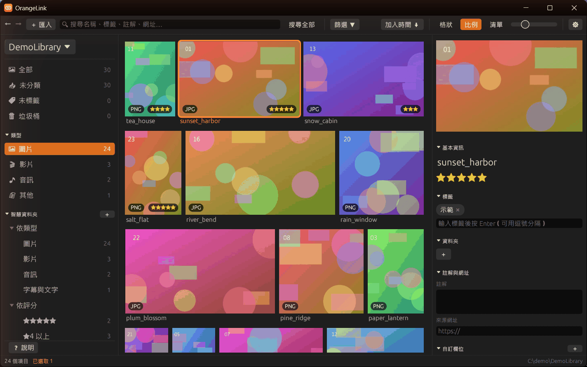
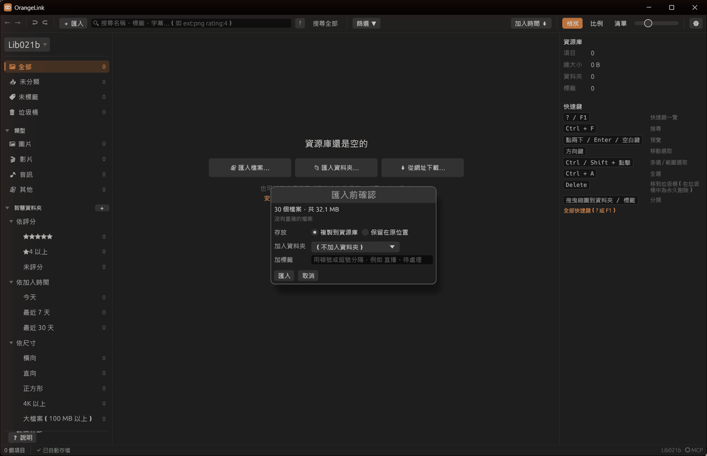
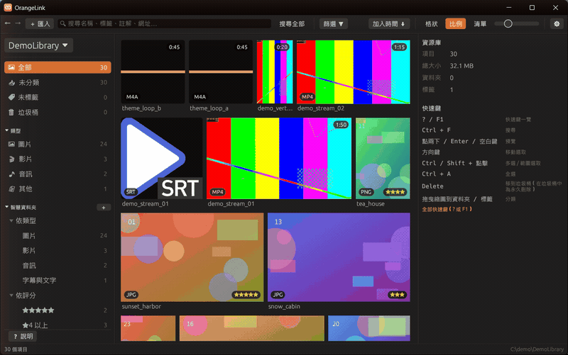
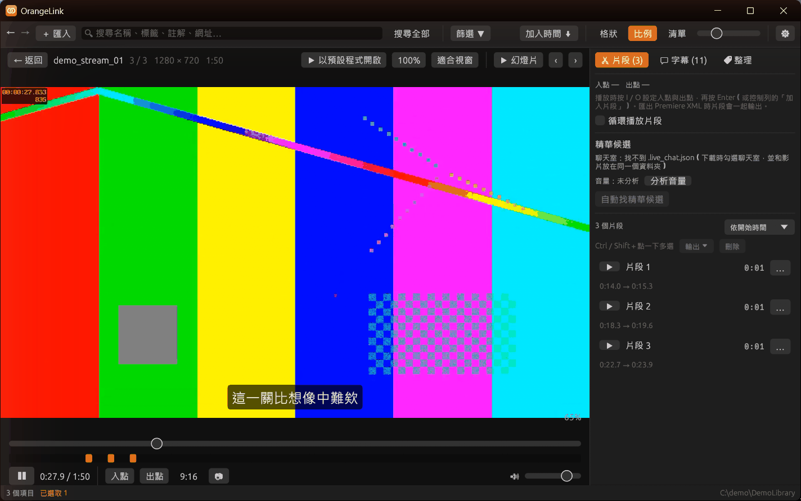
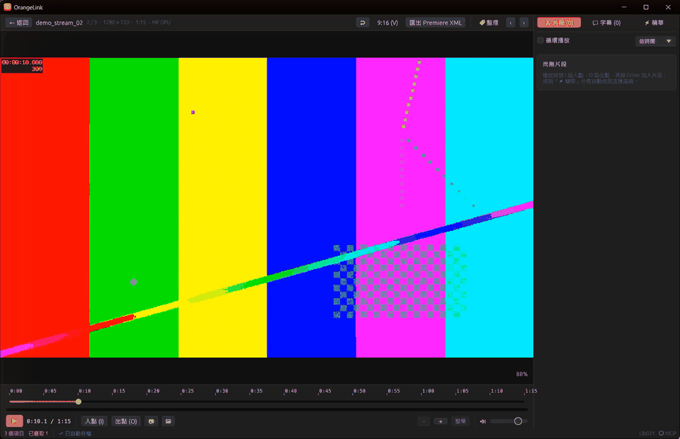
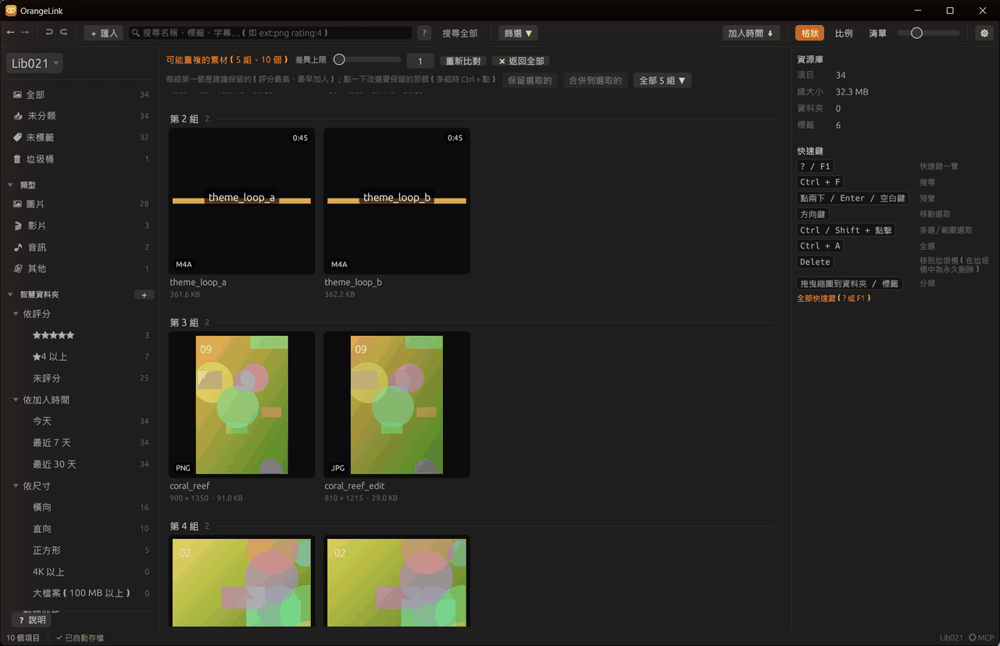
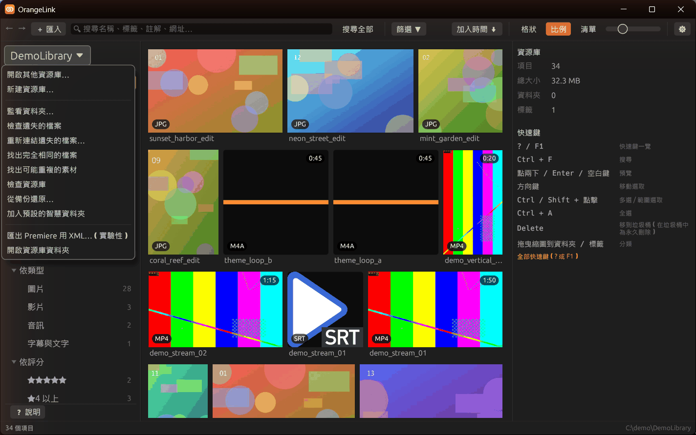

# OrangeLink

[繁體中文](../README.md) · [简体中文](README.zh-CN.md) · [English](README.en.md) · [日本語](README.ja.md) · **한국어**

*인터페이스는 번체 중국어, 간체 중국어, 영어, 일본어, 한국어로 표시할 수 있습니다(설정 → 일반 → 언어). 자세한 문서(FEATURES.md)는 번체 중국어로 작성되어 있습니다.*



## 이것은 무엇인가요?

OrangeLink는 Windows에서 소재 관리와 영상 편집 작업 흐름을 돕는 도구입니다. 이미지, 영상, 오디오, 자막 및 기타 파일을 하나의 라이브러리에 모으고, 태그, 별점, 폴더로 정리한 뒤, 검색 구문으로 필요한 소재를 빠르게 찾을 수 있습니다.

특히 긴 영상을 다루는 분에게 적합합니다. 예를 들어 생방송 녹화나 인터뷰를 같은 곳에서 검색하고, 자막을 찾고, 영상에 클립을 표시하고, 하이라이트 후보를 찾고, 세로형 짧은 영상을 내보내고, Premiere Pro용 XML로 내보낼 수 있습니다.

- 단일 실행 파일이므로 압축만 풀면 바로 사용할 수 있으며, 설치 프로그램이 필요하지 않습니다.
- 라이브러리는 순수한 파일 구조이고 데이터베이스가 없으므로, 언제든 백업하거나 다른 도구로 읽을 수 있습니다.
- 음성 인식(텍스트 변환), 재생, 썸네일은 모두 로컬에서 처리됩니다. 프로그램은 소재나 기록을 자동으로 업로드하지 않습니다.

## 주요 기능

### 소재 정리: 라이브러리, 태그, 스마트 폴더

- 이미지, 영상, 오디오, 자막 및 기타 파일을 한곳에서 관리하며, 라이브러리를 여러 개 만들 수 있습니다.
- 가져올 때 "라이브러리로 복사"를 선택할 수도 있고, "원래 위치에 유지"를 선택해 색인과 썸네일만 만들 수도 있습니다. 대용량 소재 보관에 적합합니다.
- 파일을 한꺼번에 많이 끌어다 놓으면, 먼저 파일 수, 전체 용량, 중복 개수를 보여 줍니다. 어느 폴더에 넣을지, 어떤 태그를 붙일지 정한 뒤 확인을 눌러야 가져옵니다.
- 폴더, 태그, ★1–5 별점, 메모, 사용자 지정 필드를 지원합니다. "감시 폴더"를 설정하면 새 파일을 자동으로 가져오고 태그를 붙일 수 있습니다.
- 스마트 폴더는 검색 및 필터 조건을 동적인 폴더로 저장합니다.



### 검색

이름, 태그, 메모, URL, 자막 대사를 검색할 수 있으며, `ext:png rating:4`, `고양이 OR 강아지`, `-초안`, `dur>10m`, `w>=1920`처럼 조건을 조합할 수 있습니다. 전체 구문은 프로그램에서 `?`를 누르면 볼 수 있으며, [FEATURES.md](FEATURES.md)에도 나와 있습니다.



### 영상, 자막, 클립 미리 보기

- 영상과 오디오는 프로그램 안에서 바로 재생합니다. 기본은 Windows의 Media Foundation(GPU 하드웨어 디코딩)을 사용하며, 열 수 없는 형식은 자동으로 FFmpeg을 사용합니다.
- 같은 이름의 `.srt`/`.vtt` 자막을 자동으로 찾아, 미리 보기에서 대사를 한 줄씩 보여 줍니다. 한 줄을 클릭하면 해당 시간으로 이동합니다. Whisper를 사용해 영상이나 오디오를 로컬에서 자막으로 변환할 수도 있습니다.
- I／O 키로 시작점과 끝점을 표시하고, 클립으로 추가한 뒤 파일로 내보낼 수 있습니다(쇼츠용 세로형 1080×1920 기본 프리셋 포함).





### 라이브 방송 하이라이트 후보와 Premiere XML

라이브 방송 녹화를 미리 볼 때, 진행 막대 위에 채팅 활성도(같은 이름의 `.live_chat.json`을 읽음)와 음량을 표시합니다. 활성도가 높은 시점 전후로 하이라이트 후보를 자동으로 만들고, 선택된 이유도 함께 표시합니다. 선택한 클립은 Premiere Pro용 XML로 내보낼 수 있습니다(실험적 기능이며, 모든 버전에서 완전히 읽힌다고 보장하지는 않습니다).

### 유사 및 중복

내용이 완전히 같은 파일이나 썸네일이 비슷한 소재를 찾을 수 있습니다. 결과는 그룹으로 표시되며, 하나만 남기고 태그와 메모를 합치거나, 나머지를 휴지통으로 옮길 수 있습니다. 모든 작업은 되돌릴 수 있습니다.



### 데이터 안전

수정 내용은 2초마다 자동 저장되고, 매일 자동으로 백업됩니다. 라이브러리 메뉴에서 백업을 복원할 수 있습니다. 폴더 구조 파일이 손상되면 백업에서 자동으로 되돌립니다. 영구 삭제는 기본적으로 라이브러리 데이터만 제거하며, 원본 파일은 그대로 보존합니다.



더 많은 기능(PDF 미리 보기, 전역 단축키, 일괄 이름 변경, 사용 기록, 다크/라이트 테마 등)은 [FEATURES.md](FEATURES.md)를 참고하십시오.

## 다운로드 및 설치

**시스템 요구 사항: Windows 10 또는 11(64비트).**

1. [GitHub Releases](https://github.com/rightstar2015/OrangeLink/releases)에서 `OrangeLink-v版本-windows-x64.zip`을 내려받습니다.
2. 아무 폴더에나 압축을 풀고 `OrangeLink.exe`를 실행합니다.
3. 같은 Release에 첨부된 `SHA256SUMS.txt`로 다운로드한 파일이 손상되지 않았는지 확인할 수 있습니다: `sha256sum -c SHA256SUMS.txt`.

아래의 외부 도구는 zip 파일에 **포함되어 있지 않으며**, 필요할 때 따로 설치해야 합니다(모두 프로그램 안에서 한 번에 설치할 수 있습니다).

| 도구 | 용도 |
| --- | --- |
| [FFmpeg](https://ffmpeg.org/) | 영상 썸네일, 재생 대체 수단, 클립 내보내기, 음성 자막 변환(음성 자막 변환에는 내장 whisper가 포함된 FFmpeg 8 이상이 필요합니다) |
| [yt-dlp](https://github.com/yt-dlp/yt-dlp) | URL에서 영상, 오디오, 라이브 방송 채팅을 내려받기 |

이들을 설치하지 않아도 다른 기능은 사용할 수 있습니다. 새 버전이 발표되면 OrangeLink가 새 버전이 있음을 알려 드립니다. 그러면 GitHub Releases에서 직접 내려받아 업데이트하십시오(자세한 내용은 [FEATURES.md](FEATURES.md#更新與回報問題)를 참고하십시오). 0.1.6부터 0.1.9까지의 버전은 이후의 새 버전을 알려 주지 않으므로, 한 번 직접 내려받으십시오.

## 빠른 시작

1. OrangeLink를 열고 "＋ 새 라이브러리…"를 누른 뒤 폴더를 하나 선택합니다.
2. 이미지, 영상 또는 폴더 전체를 창으로 끌어다 놓습니다. 파일이 20개를 넘으면 먼저 가져오기 전 확인 창이 나타납니다.
3. 소재를 선택한 뒤 `0`～`5`를 눌러 별점을 매기고, 오른쪽 패널에 태그를 입력한 뒤 Enter를 누릅니다.
4. `Ctrl + F`로 검색하거나, 왼쪽의 유형, 폴더, 태그, 스마트 폴더를 클릭해 둘러봅니다.
5. 영상을 더블클릭해 미리 보고, I／O 키로 클립을 표시한 뒤, 오른쪽의 "자막" 탭에서 원하는 대사로 이동합니다.
6. `?` 또는 F1을 누르면 모든 단축키를 볼 수 있습니다.

## 단축키

`?` 또는 F1을 누르면 프로그램에서 이 표를 열 수 있습니다.

일반:

| 키 | 동작 |
| --- | --- |
| ? / F1 | 단축키 목록 |
| Ctrl + F | 검색 |
| Ctrl + K | 폴더·스마트 폴더·태그로 이동하거나 명령 실행 (선택한 항목이 있으면 폴더 추가·태그 지정도 가능) |
| Alt + ← / Alt + → | 이전/다음 보기 (폴더, 태그, 검색, 유사 결과 등. 스크롤 위치와 선택 포함, 마우스 옆 버튼도 가능) |
| Ctrl + Z / Ctrl + Y | 실행 취소/다시 실행 (태그, 별점, 이름, 폴더, 스마트 폴더, 태그 그룹, 필드 등의 변경. AI의 변경 포함) |
| Ctrl + C | 선택한 파일 복사 (파일 탐색기, Premiere에 붙여 넣기 가능) |
| Ctrl + V | 클립보드의 파일이나 스크린샷 가져오기 |
| Ctrl + Alt + Shift + O | 어느 프로그램에서든 OrangeLink를 불러와 검색창에 초점 (설정에서 바꿀 수 있음) |

격자 보기:

| 키 | 동작 |
| --- | --- |
| 두 번 클릭 / Enter / 스페이스 | 미리 보기 |
| 방향키 | 선택 이동 |
| Ctrl / Shift + 클릭 | 여러 개 선택 / 범위 선택 |
| 빈 곳에서 끌기 | 영역 선택 (Ctrl / Shift를 누르면 추가 선택, 목록 보기에서는 이름이 아닌 열에서 끌기 시작) |
| Ctrl + A | 모두 선택 |
| 0~5 | 선택한 항목에 별점 (0 = 지우기) |
| F2 | 이름 바꾸기: 하나를 선택하면 그 자리에서 편집 (Enter 확인, Esc 취소), 여러 개면 일괄 이름 바꾸기 열기 |
| Delete | 휴지통으로 이동 (휴지통 안에서는 영구 삭제) |
| Ctrl + 휠 | 썸네일 크기 조정 (격자, 비율 보기) |
| 썸네일을 폴더 / 태그로 끌기 | 분류 |
| Esc | 선택 해제 |

이미지 및 PDF 미리 보기:

| 키 | 동작 |
| --- | --- |
| ← / → / ↑ / ↓ | 이전 / 다음 이미지 (PDF는 페이지 넘김, 마지막 페이지 다음은 다음 소재) |
| PageUp / PageDown | PDF 페이지 넘기기 |
| Ctrl + ← / → | 이전 / 다음 소재 |
| 휠 | 확대/축소 (PDF는 페이지 넘김, Ctrl + 휠로 확대/축소) |
| 두 번 클릭 | 창에 맞추기와 100% 사이 전환 |
| 0~5 | 현재 소재에 별점 |
| Esc / Enter / 스페이스 | 미리 보기 닫기 |

동영상 및 오디오 미리 보기:

| 키 | 동작 |
| --- | --- |
| 스페이스 / K | 재생 또는 일시 정지 / 일시 정지하고 보통 속도로 |
| L | 재생. 재생 중 다시 누르면 2×, 4× (Media Foundation) |
| ← / → | 5초 뒤로 / 앞으로 |
| Shift + ← / → | 1초 뒤로 / 앞으로 |
| , / . | 이전 / 다음 프레임 (먼저 일시 정지) |
| J | 역재생, 다시 누르면 빨라짐 (Media Foundation, FFmpeg 재생 엔진은 5초 뒤로) |
| Home / End | 처음 / 끝으로 이동 |
| I / O | 클립 시작점 / 끝점 설정 |
| Enter | 시작점이나 끝점이 있으면 클립 추가 |
| V | 9:16 자르기 프레임 전환 (가로 동영상) |
| Ctrl + ← / →, PageUp / PageDown | 이전 / 다음 소재 |
| ↑ / ↓, [ / ] | 이전 / 다음 클립 (선택 후 재생) |
| Y / N | 선택한 클립을 유지 / 삭제하고 다음으로 이동 (실행 취소 가능) |
| Delete | 클립 탭에서 클립을 선택했을 때 그 클립 삭제 (실행 취소 가능) |
| 0~5 | 현재 소재에 별점 |
| Esc | 미리 보기 닫기 |

이동할 때 화면 가운데에 "+5s" 같은 안내가 잠시 표시됩니다. 타임라인을 드래그하면 Media Foundation은 지나가는 화면을 계속 보여 줍니다(재생 중이면 먼저 일시 정지하고, 손을 떼면 그 위치에서 이어서 재생합니다). FFmpeg은 손을 뗀 뒤에야 이동합니다. 일시 정지 상태에서 이동하거나 한 프레임씩 넘길 때도 해당 위치의 화면을 보여 줍니다. 클립 목록의 ▶은 끝점에 도달하면 멈추며, "클립 반복 재생"을 체크하면 시작점부터 다시 재생합니다.

## 고급 기능

- **AI 정리(MCP)**: 설정에서 로컬 MCP 서버를 켜면 Claude 등 AI 어시스턴트가 소재를 검색하고, 썸네일을 보고, 태그를 붙이고, 별점을 매기고, 폴더를 정리할 수 있습니다. 기본은 조회만 가능하며, 데이터베이스를 수정하려면 별도로 권한을 부여해야 합니다. 모든 수정은 되돌릴 수 있으며, AI는 소재나 어떤 파일도 삭제하지 않습니다. 로컬 연결만 허용하며 토큰이 필요합니다. 설정 방법, 도구 목록, 권한 설명은 [FEATURES.md](FEATURES.md#ai-整理mcp)를, 보안 설계는 [SECURITY.md](../SECURITY.md)를 참고하십시오.
- **브라우저 확장 기능(Brave / Chrome / Edge)**: 웹페이지의 이미지, 영상 또는 파일 링크에서 마우스 오른쪽 버튼을 눌러 "OrangeLink에 추가"를 선택하면, 라이브러리로 바로 들어가며 출처 페이지도 함께 기록됩니다. 로컬 연결과 올바른 페어링 코드만 허용하며, 실행 파일 등 위험한 형식은 거부합니다. 설치 방법과 권한 설명은 [FEATURES.md](FEATURES.md#瀏覽器擴充功能brave--chrome--edge)를, 보안 내용은 [SECURITY.md](../SECURITY.md)를 참고하십시오.
- **URL에서 내려받기**: "＋ 가져오기" → "URL에서 내려받기"를 선택하면, 설치한 yt-dlp로 mp4, mp3, m4a 또는 라이브 방송 채팅을 내려받아 자동으로 가져옵니다. 사용할 권한이 있는 콘텐츠만 내려받고, 각 사이트의 이용 약관과 저작권 관련 법규를 준수하십시오. 자세한 내용은 [FEATURES.md](FEATURES.md#從網址下載yt-dlp)를 참고하십시오.

## 소스 코드에서 빌드

Rust가 필요합니다(버전은 `rust-toolchain.toml`에 고정되어 있으며, rustup이 해당 버전을 자동으로 설치합니다).

```powershell
cargo build --release --locked
```

실행 파일은 `target\release\orangelink.exe`에 생성됩니다. 개발할 때는 `.\scripts\dev-sandbox.ps1`로 실행하십시오. 이 스크립트는 설정과 라이브러리를 실제 `%APPDATA%`가 아닌 `_test_sandbox\`에 둡니다. 테스트, 커밋 규칙, 개발 참여 방법은 [CONTRIBUTING.md](../CONTRIBUTING.md)를 참고하십시오. 릴리스는 관리자의 작업이며, [RELEASING.md](RELEASING.md)를 참고하십시오.

## 라이선스, 감사의 말 및 면책 조항

OrangeLink는 [MIT 라이선스](../LICENSE)로 배포됩니다. 일부 파일은 [Prime Files](https://github.com/CakeDev4k/prime-files)(MIT)에서 가져와 수정했으며, 인터페이스 색상은 [Catppuccin](https://github.com/catppuccin/egui)(MIT)을 기반으로 합니다. 실행 파일에 포함된 패키지와 글꼴, 그리고 함께 제공되지 않는 외부 프로그램(FFmpeg, yt-dlp, Whisper 모델 등)은 모두 [THIRD_PARTY_NOTICES.md](../THIRD_PARTY_NOTICES.md)에 나열되어 있습니다.

OrangeLink는 독립 프로젝트이며, 어떤 상업용 소재 관리 소프트웨어와도 제휴나 호환 관계가 없습니다. Adobe와 Premiere Pro는 Adobe의 상표이며, 본 프로젝트는 Adobe와 제휴 관계가 없습니다. 내보낸 XML은 일반적인 교환 형식이며, 모든 Premiere Pro 버전에서 완전히 읽힌다고 보장하지 않습니다. 본 소프트웨어는 MIT 라이선스에 따라 "있는 그대로" 제공되며 어떠한 보증도 하지 않습니다. 중요한 소재와 라이브러리는 직접 백업하십시오.

## 문제 신고

- 일반 문의 및 제안: [GitHub Issues](https://github.com/rightstar2015/OrangeLink/issues)에서 issue를 등록해 주십시오(GitHub 계정 필요). 프로그램의 "❓ 도움말" → "문제 신고"를 선택해도 같은 페이지가 열립니다.
- 신고할 때는 "…" 메뉴에서 최근 200줄의 기록을 복사해 붙여넣을 수 있습니다. 기록에 있는 사용자 폴더는 `~`로 표시되며, 토큰과 페어링 코드는 가려지고, 자동으로 업로드되지 않습니다.
- **보안 문제는 공개 issue로 신고하지 마십시오.** 신고 방법은 [SECURITY.md](../SECURITY.md)를 참고하십시오.
