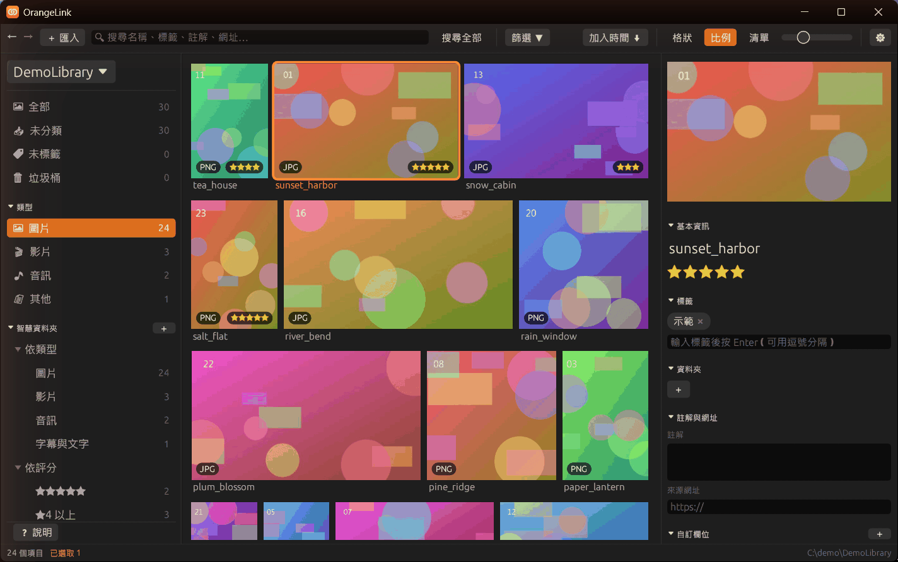
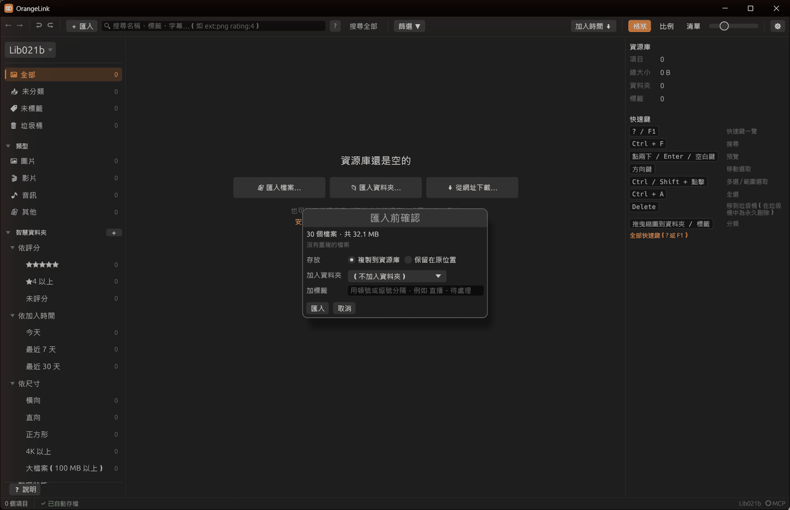
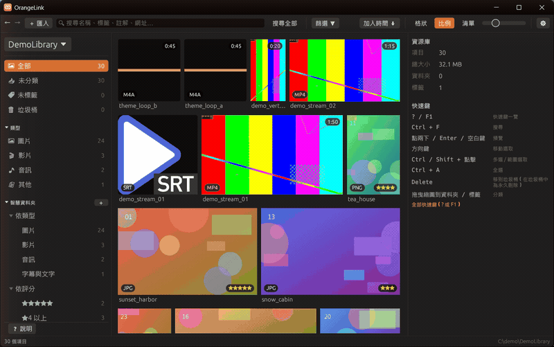
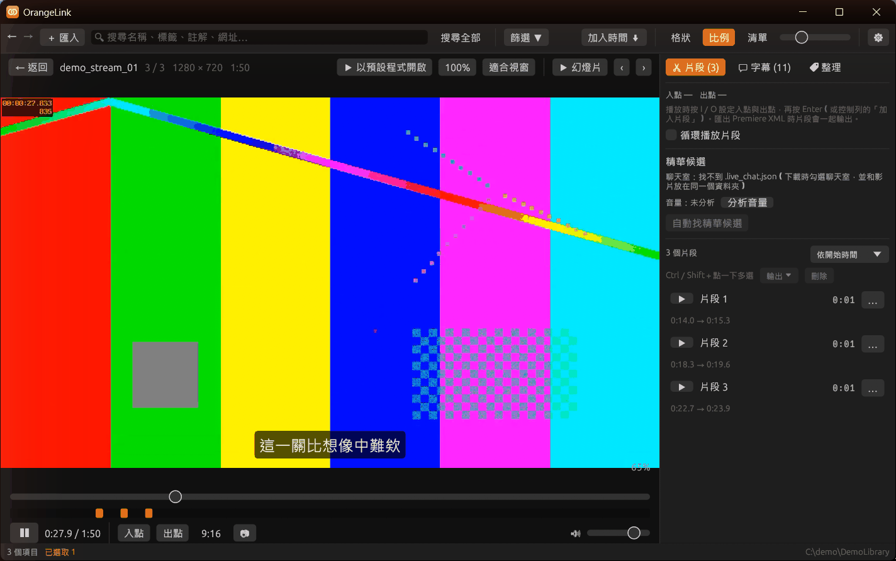
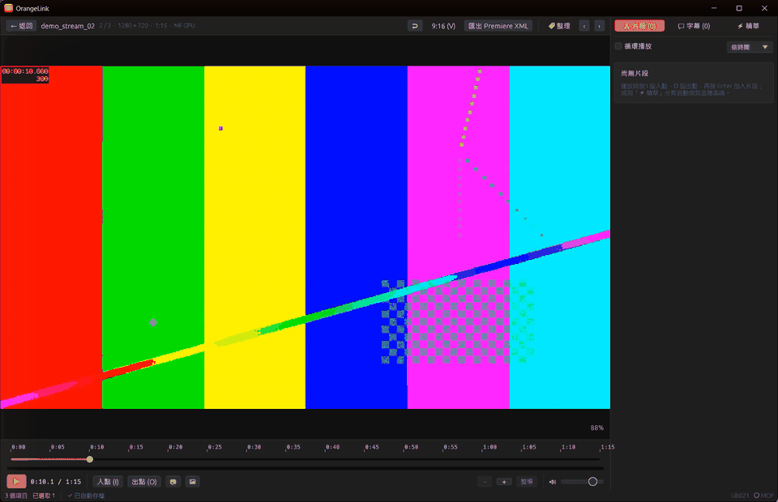
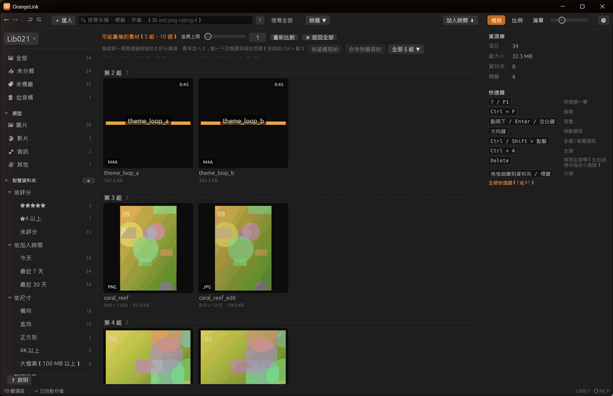
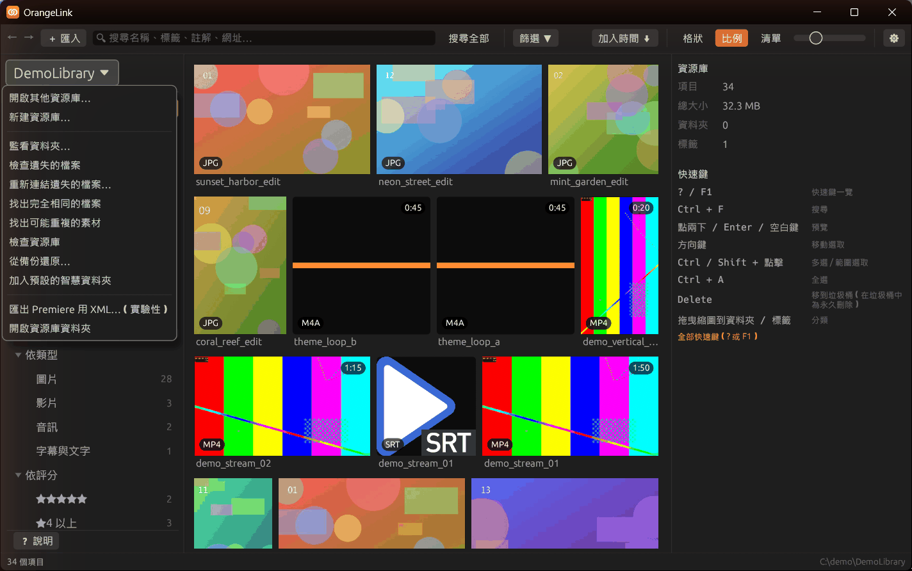

# OrangeLink

[繁體中文](../README.md) · **简体中文** · [English](README.en.md) · [日本語](README.ja.md) · [한국어](README.ko.md)

*界面可显示为繁体中文、简体中文、英文、日文和韩文（设置 → 常规 → 语言）；详细说明（FEATURES.md）为繁体中文。*



## 这是什么

OrangeLink 是 Windows 上的素材管理与视频剪辑工作流工具。你可以把图片、视频、音频、字幕和其他文件集中在一个资源库里，用标签、评分和文件夹整理，再用搜索语法快速找出要用的素材。

它特别适合会处理长视频的人，例如直播录像或访谈：可以在同一个地方搜索字幕、在视频上标记片段、找出精华候选、输出竖版短片，并导出成 Premiere Pro 的 XML。

- 单一可执行文件，解压缩就能用，不需要安装程序。
- 资源库是纯文件结构，没有数据库，随时可以备份或用其他工具读取。
- 语音转文字、播放和缩略图都在本机处理；程序不会自动上传你的素材或日志。

## 主要功能

### 整理素材：资源库、标签、智能文件夹

- 图片、视频、音频、字幕与其他文件集中管理，可建立多个资源库。
- 导入时可以「复制到资源库」，也可以「保留在原位置」只建立索引与缩略图，适合大型素材库。
- 一次拖进很多文件时，会先显示文件数、总大小和重复数，让你决定放进哪个文件夹、加哪些标签，确认后才导入。
- 文件夹、标签、★1–5 评分、备注、自定义字段；可以设置「监视文件夹」，新文件自动导入并加标签。
- 智能文件夹把搜索与筛选条件存成动态的文件夹。



### 搜索

名称、标签、备注、网址和字幕台词都能搜索，并支持组合条件，例如 `ext:png rating:4`、`猫 OR 狗`、`-草稿`、`dur>10m`、`w>=1920`。完整语法在程序里按 `?` 就能看到，也列在 [FEATURES.md](FEATURES.md)。



### 预览视频、字幕与片段

- 视频与音频直接在程序内播放，默认用 Windows 的 Media Foundation（GPU 硬件解码），打不开的格式自动改用 FFmpeg。
- 自动找同名的 `.srt`／`.vtt` 字幕，预览时列出每句台词，点一句就跳到那个时间；也可以用 Whisper 在本机把视频或音频转成字幕。
- 按 I／O 标记入点与出点，加入片段并导出成文件（含 Shorts 用的竖版 1080×1920 预设）。





### 直播精华候选与 Premiere XML

预览直播录像时，进度条上方可以显示聊天室热度（读取和视频同名的 `.live_chat.json`）与音量，并自动在高峰前后建立精华候选，标出被选上的原因。选好的片段可以导出成 Premiere Pro 用的 XML（实验性，不保证每个版本都能完整读取）。

### 相似与重复

可以找出内容完全相同的文件，或缩略图相似的素材；结果分组显示，可以保留一个、合并标签与备注，或把其他的移到回收站，操作都可以撤销。



### 资料安全

修改后每 2 秒自动保存，并每天自动备份，可以从资源库菜单恢复；文件夹结构文件损坏时会自动从备份取回。永久删除默认只移除资源库数据、保留你的原始文件。



更多功能（PDF 预览、全局快捷键、批量重命名、使用日志、深色与浅色主题等）见 [FEATURES.md](FEATURES.md)。

## 下载与安装

**系统需求：Windows 10 或 11（64 位）。**

1. 到 [GitHub Releases](https://github.com/rightstar2015/OrangeLink/releases) 下载 `OrangeLink-v版本-windows-x64.zip`。
2. 解压缩到任何文件夹，运行 `OrangeLink.exe`。
3. 可以用同一个 Release 附的 `SHA256SUMS.txt` 确认下载没有损坏：`sha256sum -c SHA256SUMS.txt`。

下面这些外部工具**不包含**在 zip 里，需要时另外安装（都可以在程序里一键安装）：

| 工具 | 用途 |
| --- | --- |
| [FFmpeg](https://ffmpeg.org/) | 视频缩略图、播放备用、片段输出、语音转字幕（语音转字幕需要内置 whisper 的 FFmpeg 8 以上） |
| [yt-dlp](https://github.com/yt-dlp/yt-dlp) | 从网址下载视频、音频与直播聊天室 |

没有安装它们也能使用其他功能。新版本发布后，OrangeLink 会提示有新版，请到 GitHub Releases 手动下载更新（细节见 [FEATURES.md](FEATURES.md#更新與回報問題)）。0.1.6 到 0.1.9 版不会提示之后的新版，请手动下载一次。

## 快速上手

1. 打开 OrangeLink，按「＋ 新建资源库…」选一个文件夹。
2. 把图片、视频或整个文件夹拖进窗口；超过 20 个文件时会先出现导入前确认。
3. 点素材选取，按 `0`～`5` 评分；在右侧面板输入标签后按 Enter。
4. 按 `Ctrl + F` 搜索，或点左侧的类型、文件夹、标签、智能文件夹浏览。
5. 双击视频预览，按 I／O 标记片段，在右侧的「字幕」标签页跳到想要的台词。
6. 按 `?` 或 F1 查看所有快捷键。

## 快捷键

按 `?` 或 F1 可以在程序里打开这张表。

常规：

| 按键 | 动作 |
| --- | --- |
| ? / F1 | 快捷键一览 |
| Ctrl + F | 搜索 |
| Ctrl + K | 前往文件夹、智能文件夹、标签或执行指令（有选取时也能直接加入文件夹或标签） |
| Alt + ← / Alt + → | 上一个 / 下一个查看（文件夹、标签、搜索、相似结果…，含滚动位置与选择；鼠标侧键也可以） |
| Ctrl + Z / Ctrl + Y | 撤销 / 重做（标签、评分、名称、文件夹、智能文件夹、标签组、字段等修改，含 AI 的修改） |
| Ctrl + C | 复制选择的文件（可贴到资源管理器、Premiere） |
| Ctrl + V | 导入剪贴板里的文件或截屏 |
| Ctrl + Alt + Shift + O | 在任何程序里叫出 OrangeLink 并聚焦搜索框（可在设置修改） |

格状查看：

| 按键 | 动作 |
| --- | --- |
| 双击 / Enter / 空格键 | 预览 |
| 方向键 | 移动选择 |
| Ctrl / Shift + 点击 | 多选 / 范围选择 |
| 在空白处拖曳 | 框选（按住 Ctrl / Shift 可加选；清单查看可从名称以外的字段开始拖曳） |
| Ctrl + A | 全选 |
| 0～5 | 为选择的项目评分（0 = 清除） |
| F2 | 重命名：单选时直接在名称位置编辑（Enter 确认、Esc 取消），多选时打开批量重命名 |
| Delete | 移到垃圾桶（在垃圾桶中为永久删除） |
| Ctrl + 滚轮 | 调整缩略图大小（格状、比例查看） |
| 拖曳缩略图到文件夹 / 标签 | 分类 |
| Esc | 取消选择 |

预览图片与 PDF：

| 按键 | 动作 |
| --- | --- |
| ← / → / ↑ / ↓ | 上一张 / 下一张（PDF 为换页，翻过最后一页换到下一个素材） |
| PageUp / PageDown | PDF 换页 |
| Ctrl + ← / → | 上一个 / 下一个素材 |
| 滚轮 | 缩放（PDF 为换页，Ctrl + 滚轮缩放） |
| 双击 | 在符合窗口与 100% 之间切换 |
| 0～5 | 为目前的素材评分 |
| Esc / Enter / 空格键 | 关闭预览 |

预览视频与音频：

| 按键 | 动作 |
| --- | --- |
| 空格键 / K | 播放或暂停 / 暂停并回到正常速度 |
| L | 播放；播放中再按加速到 2×、4×（Media Foundation） |
| ← / → | 倒退 / 前进 5 秒 |
| Shift + ← / → | 倒退 / 前进 1 秒 |
| , / . | 上一格 / 下一格（会先暂停） |
| J | 倒播，再按加快（Media Foundation；FFmpeg 播放引擎是倒退 5 秒） |
| Home / End | 跳到开头 / 结尾 |
| I / O | 设置片段入点 / 出点 |
| Enter | 有入点或出点时加入片段 |
| V | 切换 9:16 裁切框（横版视频） |
| Ctrl + ← / →、PageUp / PageDown | 上一个 / 下一个素材 |
| ↑ / ↓、[ / ] | 上一个 / 下一个片段（选取并播放） |
| Y / N | 保留 / 删除选取的片段，再跳到下一个（可撤销） |
| Delete | 片段标签页有选择片段时，删除这些片段（可撤销） |
| 0～5 | 为目前的素材评分 |
| Esc | 关闭预览 |

跳转时画面中央会短暂显示「+5s」之类的提示。拖动时间轴时，Media Foundation 会一路显示经过的画面（播放中会先暂停，松开后从该处继续）；FFmpeg 则在松开后才跳转。暂停时跳转或逐帧也会显示该位置的画面。片段列表的 ▶ 播到出点会停止，勾选「循环播放片段」则会从入点重播。

## 进阶功能

- **AI 整理（MCP）**：在设置中启用本机 MCP 服务器后，Claude 等 AI 助手可以搜索素材、看缩略图、加标签、评分、整理文件夹。默认只能查看；修改数据库要另外授权，每次修改都可以撤销，AI 不会删除素材或任何文件。只接受本机连接，需要 token。设置步骤、工具列表与权限说明见 [FEATURES.md](FEATURES.md#ai-整理mcp)，安全性设计见 [SECURITY.md](../SECURITY.md)。
- **浏览器扩展（Brave / Chrome / Edge）**：在网页的图片、视频或文件链接上按右键「加入 OrangeLink」，直接进入资源库并记录来源页面。只接受本机连接与正确的配对码；可执行文件等危险格式会被拒收。安装步骤与权限说明见 [FEATURES.md](FEATURES.md#瀏覽器擴充功能brave--chrome--edge)，安全性见 [SECURITY.md](../SECURITY.md)。
- **从网址下载**：「＋ 导入」→「从网址下载」，通过你安装的 yt-dlp 下载 mp4、mp3、m4a 或直播聊天室并自动导入。请只下载你有权使用的内容，并遵守各网站的使用条款与著作权法规。细节见 [FEATURES.md](FEATURES.md#從網址下載yt-dlp)。

## 从源代码构建

需要 Rust（版本固定在 `rust-toolchain.toml`，rustup 会自动安装那一版）：

```powershell
cargo build --release --locked
```

可执行文件在 `target\release\orangelink.exe`。开发时请用 `.\scripts\dev-sandbox.ps1` 运行，它会把设置和资源库放在 `_test_sandbox\` 而不是你真实的 `%APPDATA%`。测试、commit 规则和参与开发的方式见 [CONTRIBUTING.md](../CONTRIBUTING.md)。发布是维护者的工作，见 [RELEASING.md](RELEASING.md)。

## 授权、致谢与免责声明

OrangeLink 以 [MIT 授权](../LICENSE) 发布。部分文件改写自 [Prime Files](https://github.com/CakeDev4k/prime-files)（MIT）；界面配色以 [Catppuccin](https://github.com/catppuccin/egui)（MIT）为基础。编译进可执行文件的软件包与字体，以及不随附的外部程序（FFmpeg、yt-dlp、Whisper 模型等），都列在 [THIRD_PARTY_NOTICES.md](../THIRD_PARTY_NOTICES.md)。

OrangeLink 是独立项目，与任何商业素材管理软件没有隶属或兼容关系。Adobe 与 Premiere Pro 是 Adobe 的商标，本项目与 Adobe 没有隶属关系；导出的 XML 是一般的交换格式，不保证每个 Premiere Pro 版本都能完整读取。本软件依 MIT 授权「按现状」提供，不附任何担保；请自行备份重要的素材与资源库。

## 回报问题

- 一般问题与建议：到 [GitHub Issues](https://github.com/rightstar2015/OrangeLink/issues) 开一个 issue（需要 GitHub 账号）。程序里的「❓ 说明」→「回报问题」也会打开同一个页面。
- 回报时可以从「…」菜单复制最后 200 行日志粘贴；日志里的用户文件夹会写成 `~`，token 和配对码会隐藏，也不会自动上传。
- **安全性问题请不要开公开的 issue**，回报方式见 [SECURITY.md](../SECURITY.md)。
